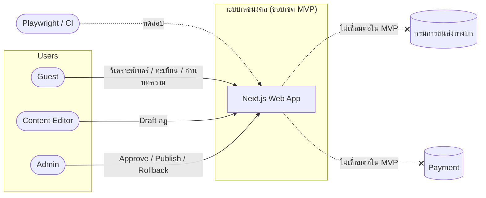
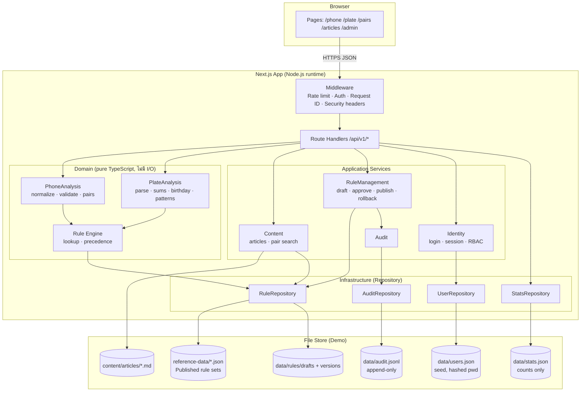

# Architecture — ระบบเลขมงคลและทะเบียนรถมงคล (MVP Demo)

> **Version:** 1.0 · **Date:** 2026-11-06 · **Status:** Accepted (Demo)
> **Input:** [System Requirements](../requirement/system-requirements.md) · [User Stories v1.3](../user-story/numerology-user-stories-review.md) · [Reference Data](../user-story/reference-data/README.md)

## 1. System Context



**ไม่มีระบบภายนอกใน MVP** — ทุกข้อมูลอยู่ใน Repository ของโปรเจกต์ (ADR-002)

## 2. Logical Architecture



### Module ↔ Requirement

| Module | ความรับผิดชอบ | FR / NFR หลัก |
| --- | --- | --- |
| PhoneAnalysis | Normalize, validate, แยก 6 คู่ (ตำแหน่ง 4–10) | FR-PH-01–09, BR-PH-01–06 |
| PlateAnalysis | Parse ทะเบียน, ผลรวม 2 แบบ, วันเกิด, รูปแบบ | FR-LP-01–11, BR-LP-01–10 |
| Rule Engine | อ่าน Rule Set ที่ Published, ใช้ precedence, คืน `ruleSet` + `version` | NFR-03, BR-LP-09 |
| RuleManagement | State machine ของ Rule, Preview, Golden test gate | FR-AD-02–08, BR-AD-01–04, NFR-04 |
| Identity | Login, Session cookie, RBAC, Lockout | FR-AD-01, NFR-05–07 |
| Audit | Append-only log | FR-AD-06, NFR-13 |
| Content | Markdown articles, ค้นหาคู่เลข | FR-CT-01–04 |
| Middleware | Rate limit, Security headers, Request ID, Mask log | NFR-07–12, NFR-18 |

## 3. Technology Choices (Radar)

| เทคโนโลยี | Category | เหตุผล |
| --- | --- | --- |
| Next.js (App Router) + TypeScript | **Adopt** | UI + API ในโปรเจกต์เดียว, Deploy ง่าย, เหมาะ Demo |
| Zod | **Adopt** | Schema validation ใช้ร่วมกัน Client/Server |
| JSON files + Repository interface | **Adopt (Demo)** | ไม่มีฐานข้อมูล (ADR-002) |
| Playwright + `@axe-core/playwright` | **Adopt** | ข้อกำหนดของอาจารย์ + A11y |
| Vitest | **Adopt** | Unit test ของ Domain (pure function) |
| argon2 / bcrypt | **Adopt** | Hash รหัสผ่าน (NFR-06) |
| .NET Backend แยก | **Hold (สำหรับ Demo)** | เพิ่ม 2 runtime โดยไม่มีประโยชน์ต่อ Demo (ADR-001) |
| PostgreSQL | **Assess** | ใช้เมื่อต้องการ Production / Multi-instance |
| Redis (rate limit) | **Assess** | ใช้เมื่อมีหลาย instance |

## 4. Architecture Decision Records

### ADR-001: Next.js Full-stack แทน Next.js + .NET

**Date:** 2026-11-06 · **Status:** Accepted (Demo)

**Context:** User Stories §15 เสนอ Next.js → .NET API → PostgreSQL แต่โปรเจกต์นี้เป็นการบ้าน Demo ที่ต้องทดสอบด้วย Playwright และไม่มีฐานข้อมูล

**Decision:** ใช้ Next.js Route Handlers เป็น API และแยก Domain เป็น TypeScript module บริสุทธิ์ (ไม่มี I/O)

**Consequences:**
+ รันด้วยคำสั่งเดียว (`npm run dev`) — Playwright `webServer` เริ่มได้ทันที
+ Domain เป็น pure function → Unit test ง่าย และ Golden tests ใช้ร่วมกันได้
− ถ้าภายหลังต้องย้ายไป .NET ต้องเขียน Domain ใหม่ (ลดผลกระทบด้วย API Contract `/api/v1` เดิม)

**Alternatives:** Next.js + .NET — rejected: 2 runtime, 2 build pipeline, เกินความจำเป็นของ Demo

### ADR-002: File-based Store ผ่าน Repository Pattern

**Date:** 2026-11-06 · **Status:** Accepted (Demo)

**Context:** ไม่มีฐานข้อมูล ข้อมูลกฎมาจาก `reference-data/*.json`

**Decision:** ทุกการเข้าถึงข้อมูลผ่าน interface `RuleRepository`, `AuditRepository`, `UserRepository`, `StatsRepository` โดย implementation แรกอ่าน/เขียนไฟล์ JSON

**Consequences:**
+ เปลี่ยนเป็น PostgreSQL ได้โดยเขียน implementation ใหม่ ไม่แตะ Domain
+ Seed ข้อมูลและ Reset ระหว่าง E2E ง่าย (copy ไฟล์)
− ไม่รองรับหลาย instance พร้อมกัน — ยอมรับสำหรับ Demo
− การเขียนพร้อมกันต้องใช้ lock + เขียนไฟล์ชั่วคราวแล้ว rename (atomic write)

**Alternatives:** SQLite — ดีกว่าเรื่อง concurrency แต่ข้อมูลอ่านด้วยตาไม่ได้; ไว้พิจารณาถ้าไฟล์เริ่มมีปัญหา

### ADR-003: Rule Set เป็น Immutable Version

**Date:** 2026-11-06 · **Status:** Accepted

**Context:** ต้องตรวจย้อนหลังได้ และ Rollback ได้โดยไม่ลบประวัติ (FR-AD-05)

**Decision:** ทุกการ Publish สร้างไฟล์ `versions/<ruleSetId>@<version>.json` ใหม่ ไม่แก้ไฟล์เดิม; ตัวชี้ `published.json` ระบุเวอร์ชันที่ใช้งาน; Rollback = สร้างเวอร์ชันใหม่ที่เนื้อหาเหมือนเวอร์ชันเก่า

**Consequences:**
+ ทุกผลวิเคราะห์อ้างเวอร์ชันได้แน่นอน (NFR-03)
+ Audit ง่าย Diff ง่าย
− ไฟล์สะสม — ยอมรับสำหรับ Demo

### ADR-004: Stateless Analysis — ไม่เก็บค่าที่ผู้ใช้กรอก

**Date:** 2026-11-06 · **Status:** Accepted

**Context:** BR-PV-01, NFR-10–12 ห้ามเก็บเบอร์/ทะเบียนของ Guest

**Decision:** API วิเคราะห์เป็น `POST` ไม่มี persistence; เพิ่มเฉพาะตัวนับใน `stats.json`; Logger มี mask function บังคับ

**Consequences:**
+ ลดความเสี่ยง PDPA
− ไม่มีประวัติให้ debug เคสที่ผู้ใช้แจ้ง — ใช้ Request ID + input ที่ถูก mask แทน

### ADR-005: Golden Tests เป็น Gate ก่อน Publish

**Date:** 2026-11-06 · **Status:** Accepted

**Decision:** การ Publish ต้องรัน `golden-cases.json` กับ Draft ใน Preview ก่อน ถ้ามีเคสเปลี่ยนผล ต้องแสดง Diff และให้ Admin ยืนยัน

**Consequences:** + ป้องกันกฎผิดหลุดขึ้นจริง (NFR-04) · − Golden ต้อง regenerate เมื่อกฎเปลี่ยนโดยตั้งใจ

### ADR-006: Session Cookie แทน JWT

**Date:** 2026-11-06 · **Status:** Accepted

**Decision:** Admin ใช้ session cookie `HttpOnly; Secure; SameSite=Strict` idle timeout 30 นาที

**Consequences:** + Logout/revoke ได้ทันที, ไม่มี token ใน JS · − ต้องเก็บ session (in-memory สำหรับ Demo — restart แล้วต้อง login ใหม่)

## 5. Failure Mode Analysis

| Operation | Failure | Likelihood | Impact | Mitigation |
| --- | --- | --- | --- | --- |
| Analyze | โหลด Rule Set ไม่ได้ / JSON เสีย | Low | High | Validate ด้วย Zod ตอน startup; ล้มเหลว = `INTERNAL_ERROR` ห้ามแสดงผลที่ไม่มีกฎ (NFR-19) |
| Analyze | ยิงถี่ | Medium | Medium | Rate limit 30/นาที/IP → 429 |
| Analyze | กดซ้ำ | Medium | Low | ปุ่ม disable ระหว่างโหลด; API เป็น idempotent (ไม่มี side effect นอกจาก counter) |
| Publish | Admin 2 คนกด Publish พร้อมกัน | Low | High | Optimistic lock ด้วย `baseVersion` → 409 `VERSION_CONFLICT` |
| Publish | เขียนไฟล์ค้างครึ่งทาง | Low | High | เขียน temp แล้ว `rename` (atomic) — ตัวชี้ `published.json` เปลี่ยนเป็นขั้นสุดท้าย |
| Publish | Golden test fail | Medium | Medium | บล็อก Publish จนกว่า Admin ยืนยัน Diff |
| Audit | เขียน log ไม่สำเร็จ | Low | High | ทำ Audit ก่อนสลับตัวชี้; ถ้า Audit ล้มเหลว ยกเลิก Publish |
| Login | Brute force | Medium | High | Lockout 5 ครั้ง/15 นาที + rate limit 10/นาที |
| Stats | เขียนพร้อมกัน | High | Low | นับใน memory แล้ว flush ทุก 10 วินาที — ยอมรับว่าค่าคลาดได้เล็กน้อย |

**Unmitigated risks (ยอมรับ):** Single instance, session หายเมื่อ restart, ไม่มี backup อัตโนมัติ — เหมาะกับ Demo เท่านั้น

## 6. NFR Coverage

| NFR | การออกแบบที่รองรับ |
| --- | --- |
| Performance (NFR-01/02) | Rule Set โหลดเข้า memory ตอน startup, Domain เป็น O(n) กับความยาว input; หน้าเว็บ SSR + ฟอร์ม Client component |
| Correctness (NFR-03/04) | Pure domain + immutable version + golden gate |
| Security (NFR-05–09) | Middleware RBAC, Zod ทุก endpoint, CSP, error envelope ไม่มี stack |
| Privacy (NFR-10–12) | ADR-004, POST only, mask logger, ไม่มี analytics ภายนอก |
| Audit (NFR-13) | `audit.jsonl` append-only |
| A11y / Compatibility (NFR-14–16) | Playwright 5 projects + axe |
| Observability (NFR-18) | `X-Request-Id` ทุก response, structured JSON log |
| Scalability | **Out of scope (Demo)** — ทางย้ายไป PostgreSQL + Redis ตาม ADR-002 |

## 7. โครงสร้างโฟลเดอร์ที่เสนอ

```
app/
  (public)/phone, plate, pairs, articles/[slug]
  admin/login, rules, pairs, categories, audit
  api/v1/phone/analyze, plate/analyze, pairs/[pair], articles, admin/*
src/
  domain/phone, plate, rule-engine        ← pure, Vitest
  application/rule-management, content, identity, audit
  infrastructure/repositories/file/*      ← ADR-002
  shared/schemas (zod), errors, logger (mask)
content/articles/*.md
data/                                     ← drafts, versions, audit, users, stats (gitignore ยกเว้น seed)
user-story/reference-data/                ← seed ของ Rule Set
tests/e2e/*.spec.ts                       ← Playwright
```
