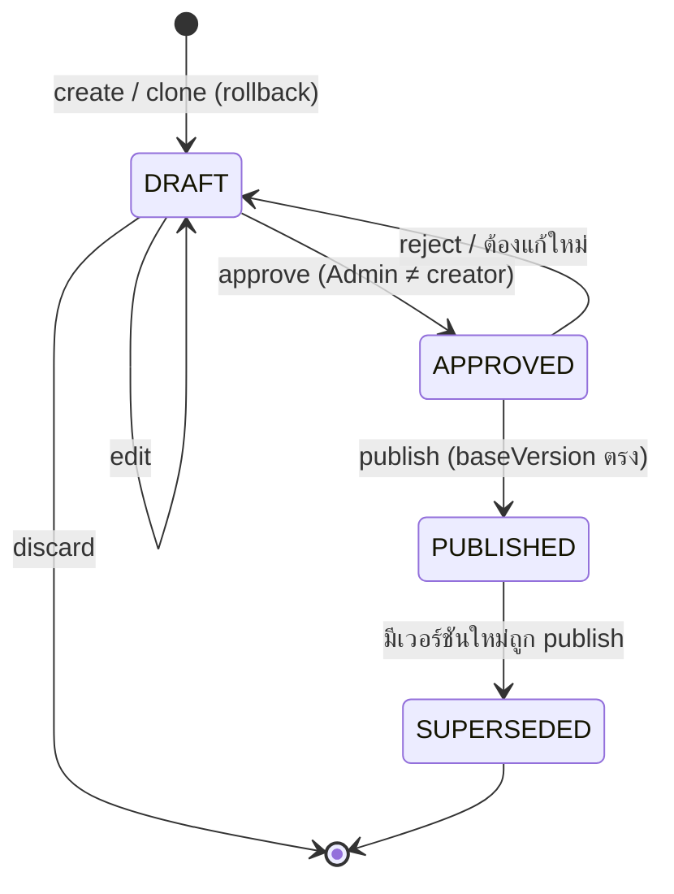

# ERD — Logical Data Model

> MVP เก็บเป็นไฟล์ JSON (ADR-002) แต่ออกแบบเป็น Entity เชิงสัมพันธ์ เพื่อย้ายไป PostgreSQL ได้ตรงๆ
> Guest ไม่มี Entity — ระบบไม่เก็บเบอร์/ทะเบียนที่กรอก (ADR-004)

```mermaid
erDiagram
  USER ||--o{ RULE_SET_VERSION : "creates"
  USER ||--o{ RULE_SET_VERSION : "approves"
  USER ||--o{ AUDIT_LOG : "performs"
  RULE_SET ||--|{ RULE_SET_VERSION : "has versions"
  RULE_SET ||--o| RULE_SET_VERSION : "published pointer"
  RULE_SET_VERSION ||--o{ PAIR_MEANING : "contains"
  RULE_SET_VERSION ||--o{ SUM_GRADE : "contains"
  RULE_SET_VERSION ||--o{ LETTER_VALUE : "contains"
  RULE_SET_VERSION ||--o{ BIRTHDAY_RULE : "contains"
  RULE_SET_VERSION ||--o{ AVOID_PATTERN : "contains"
  RULE_SET_VERSION ||--o{ CATEGORY_RULE : "contains"
  CATEGORY ||--o{ CATEGORY_RULE : "linked by"
  ARTICLE }o--|| ARTICLE_CATEGORY : "belongs to"
  ARTICLE ||--o{ ARTICLE_REFERENCE : "cites"

  USER {
    uuid id PK
    string username UK
    string password_hash
    enum role "EDITOR | ADMIN"
    int failed_login_count
    timestamp locked_until "nullable"
    timestamp created_at
  }
  RULE_SET {
    string id PK "เช่น plate-wongnai-v1"
    enum domain "PHONE | PLATE"
    string name
    string published_version_id FK "nullable"
  }
  RULE_SET_VERSION {
    uuid id PK
    string rule_set_id FK
    string version "semver, UK ร่วมกับ rule_set_id"
    enum status "DRAFT | APPROVED | PUBLISHED | SUPERSEDED"
    string source_name
    string source_url "nullable"
    boolean is_mock
    uuid based_on_version_id FK "nullable · ใช้กับ Rollback"
    uuid created_by FK
    uuid approved_by FK "nullable · ต้อง ≠ created_by"
    timestamp effective_at "nullable"
    timestamp created_at
  }
  PAIR_MEANING {
    uuid id PK
    uuid rule_set_version_id FK
    string pair_group "เช่น 24|42 · UK ต่อ version"
    enum grade "GOOD | CAUTION | AVOID"
    string categories "work, money, love, communication, health, luck"
    string pros "nullable, ≤500"
    string cons "nullable, ≤500"
    string source "required, ≤255"
  }
  SUM_GRADE {
    uuid id PK
    uuid rule_set_version_id FK
    int sum_value "1–63 · UK ต่อ version"
    enum grade "EXCELLENT | AVOID"
    string meaning "nullable"
  }
  LETTER_VALUE {
    uuid id PK
    uuid rule_set_version_id FK
    char letter "พยัญชนะไทย · UK ต่อ version"
    int value "1–9"
  }
  BIRTHDAY_RULE {
    uuid id PK
    uuid rule_set_version_id FK
    enum day "SUN | MON | TUE | WED_DAY | WED_NIGHT | THU | FRI | SAT"
    enum kind "LUCKY_DIGIT | AVOID_DIGIT | AVOID_LETTER"
    string value
  }
  AVOID_PATTERN {
    uuid id PK
    uuid rule_set_version_id FK
    enum kind "PAIR | PATTERN"
    string value "เช่น 00 หรือ one-bracket"
    string reason
    int precedence "น้อย = สำคัญกว่า"
  }
  CATEGORY {
    string id PK "เช่น trade"
    enum type "OCCUPATION | GOAL | PHONE_TYPE"
    string label
    boolean enabled
  }
  CATEGORY_RULE {
    uuid id PK
    uuid rule_set_version_id FK
    string category_id FK
    string pair_group "คู่ที่แนะนำ"
  }
  AUDIT_LOG {
    uuid id PK
    uuid actor_id FK
    enum role
    enum action "LOGIN | DRAFT_SAVED | APPROVED | PUBLISHED | ROLLBACK | CATEGORY_TOGGLED"
    string entity_type
    string entity_id
    json before "nullable"
    json after "nullable"
    string request_id
    timestamp at "UTC · append-only"
  }
  USAGE_STAT {
    date date PK
    enum type PK "PHONE | PLATE | PAIR_SEARCH | ARTICLE_VIEW"
    int count
  }
  ARTICLE {
    string slug PK
    string title
    string category_id FK
    string author
    date updated_at
    text body_markdown
  }
  ARTICLE_CATEGORY {
    string id PK
    string label
  }
  ARTICLE_REFERENCE {
    uuid id PK
    string article_slug FK
    string title
    string url
  }
```

## Invariants (ต้องบังคับใน Application Layer)

| # | Invariant | ที่มา |
| --- | --- | --- |
| I-1 | `RULE_SET_VERSION.approved_by ≠ created_by` | BR-AD-01 |
| I-2 | ต่อ `rule_set_id` มี `PUBLISHED` ได้ครั้งละ 1 เวอร์ชัน และต้องตรงกับ `RULE_SET.published_version_id` | ADR-003 |
| I-3 | เวอร์ชันที่ไม่ใช่ `DRAFT` ห้ามแก้เนื้อหา (immutable) | ADR-003 |
| I-4 | `PAIR_MEANING.pair_group` ไม่ซ้ำภายในเวอร์ชันเดียวกัน และคู่หนึ่งอยู่ได้แค่กลุ่มเดียว | BR-AD-03 |
| I-5 | `PAIR_MEANING.source` ห้ามว่าง | BR-AD-04 |
| I-6 | `LETTER_VALUE.value` อยู่ในช่วง 1–9 และอักษรหนึ่งตัวมีค่าเดียว | BR-LP-06 |
| I-7 | `AUDIT_LOG` เพิ่มได้อย่างเดียว ห้าม update/delete | NFR-13 |
| I-8 | `USAGE_STAT` ห้ามมีค่าที่ผู้ใช้กรอก | BR-PV-01 |
| I-9 | `CATEGORY_RULE.category_id` ต้องชี้ไปยัง `CATEGORY` ที่มีอยู่ | FR-AD-07 |

## State: RULE_SET_VERSION

## Mapping ไปยังไฟล์ (Demo)

| Entity | ไฟล์ |
| --- | --- |
| RULE_SET_VERSION + ลูก (Published seed) | `user-story/reference-data/*.json` |
| RULE_SET_VERSION (Draft / version ใหม่) | `data/rules/<ruleSetId>/<version>.json` |
| RULE_SET.published_version_id | `data/rules/published.json` |
| USER | `data/users.json` (seed, password hash) |
| AUDIT_LOG | `data/audit.jsonl` |
| USAGE_STAT | `data/stats.json` |
| ARTICLE | `content/articles/<slug>.md` (front-matter: title, category, author, updatedAt, references) |
