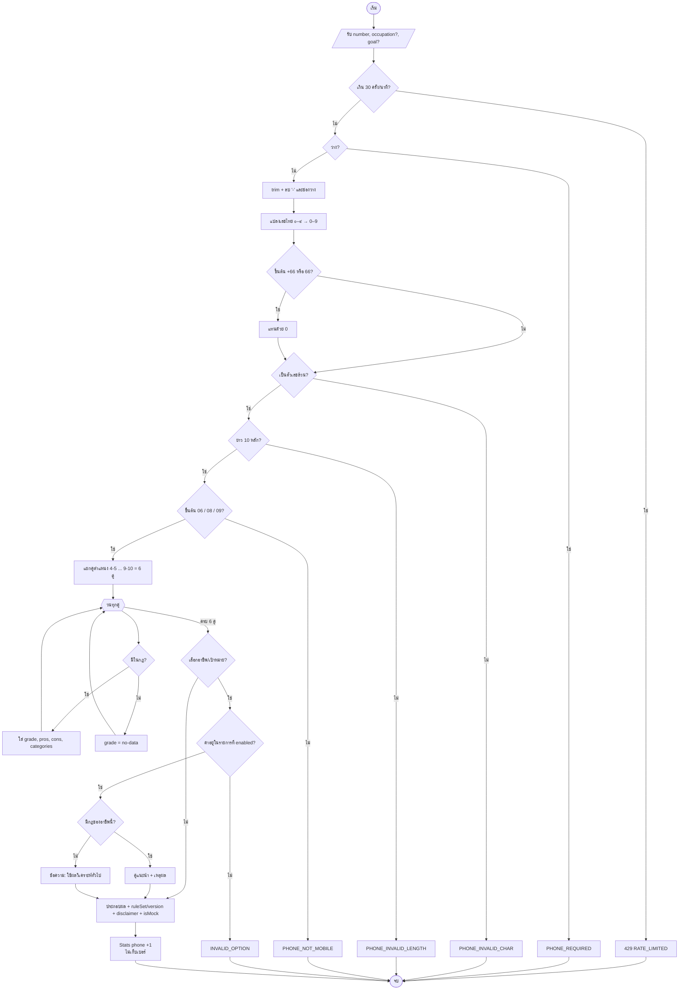
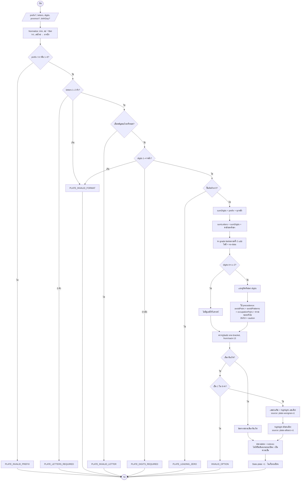
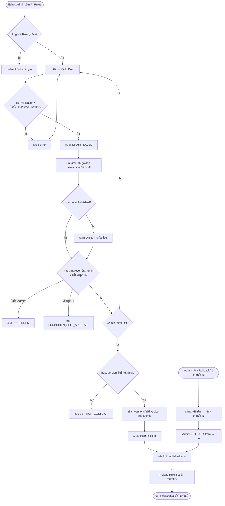
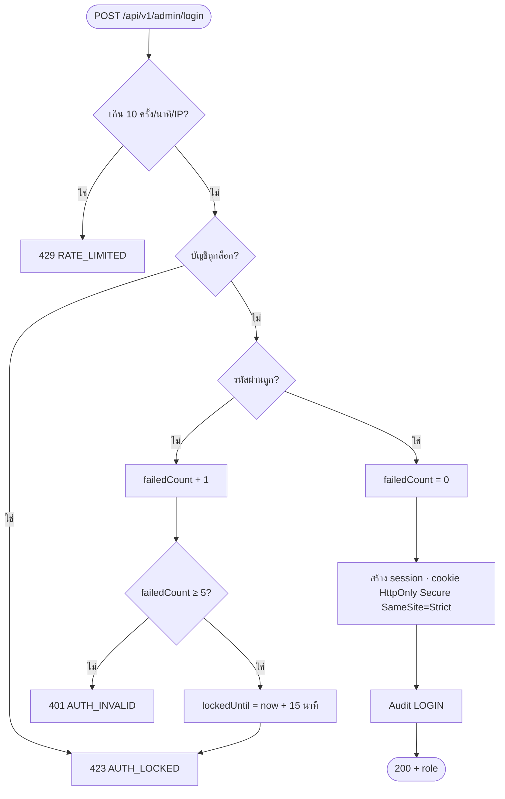

# Flowchart — ระบบเลขมงคลและทะเบียนรถมงคล

## 1. วิเคราะห์เบอร์โทรศัพท์ (UC-01, UC-02)

## 2. วิเคราะห์ทะเบียนรถ (UC-03, UC-04)

## 3. Rule Lifecycle — Draft → Publish → Rollback (UC-08 ถึง UC-11)

## 4. Admin Login (UC-07)

