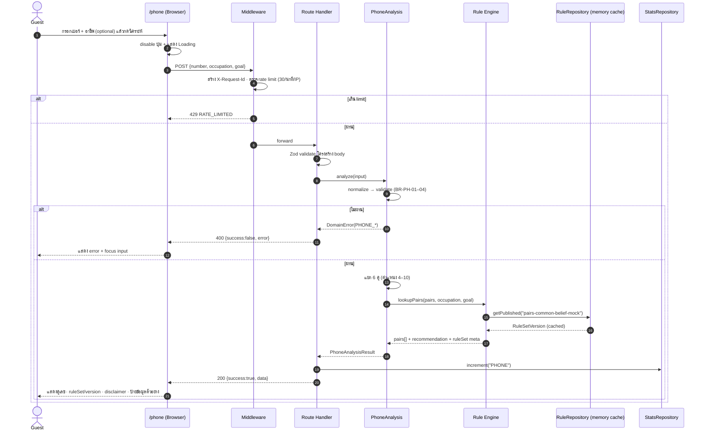
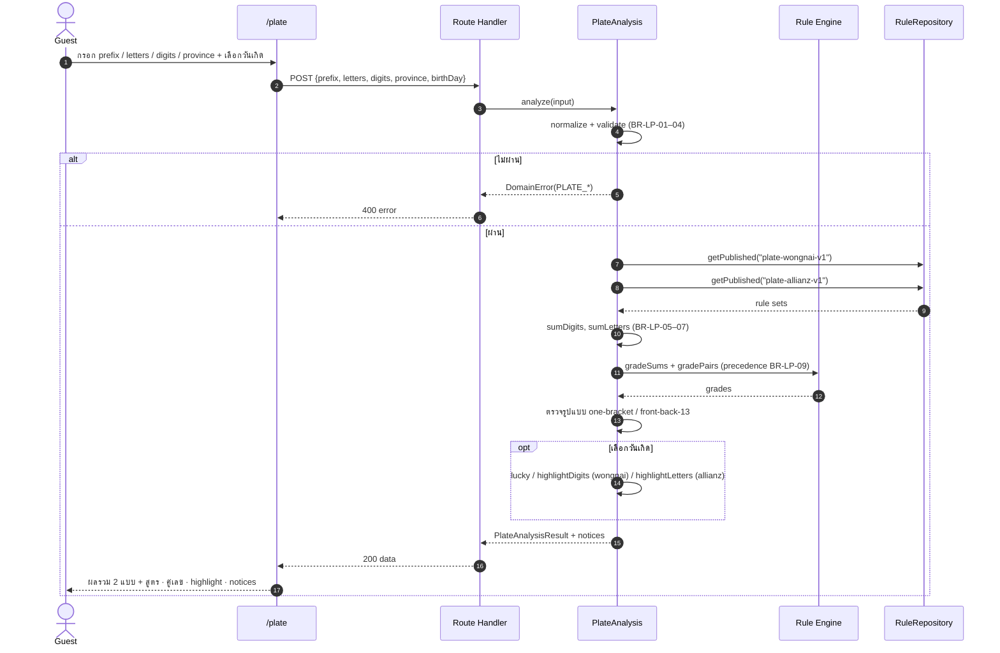
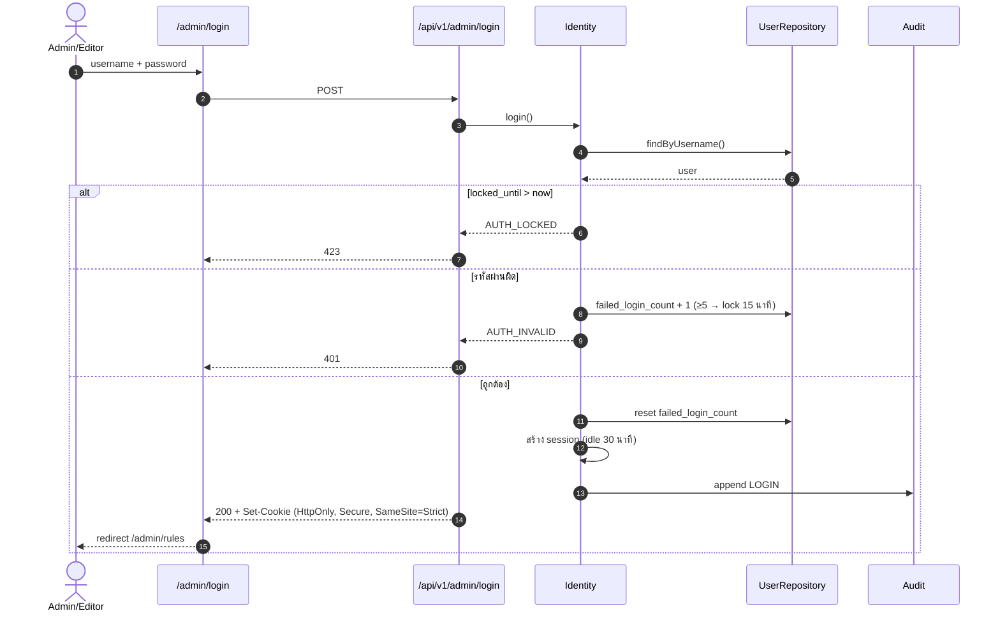
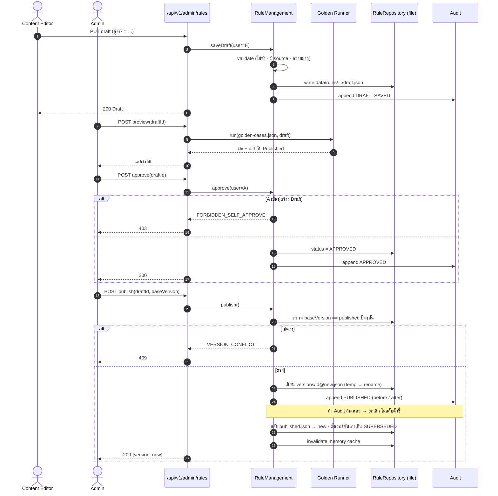
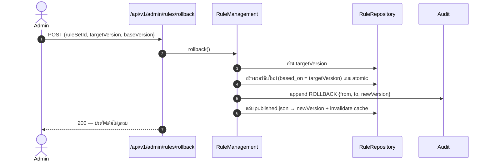
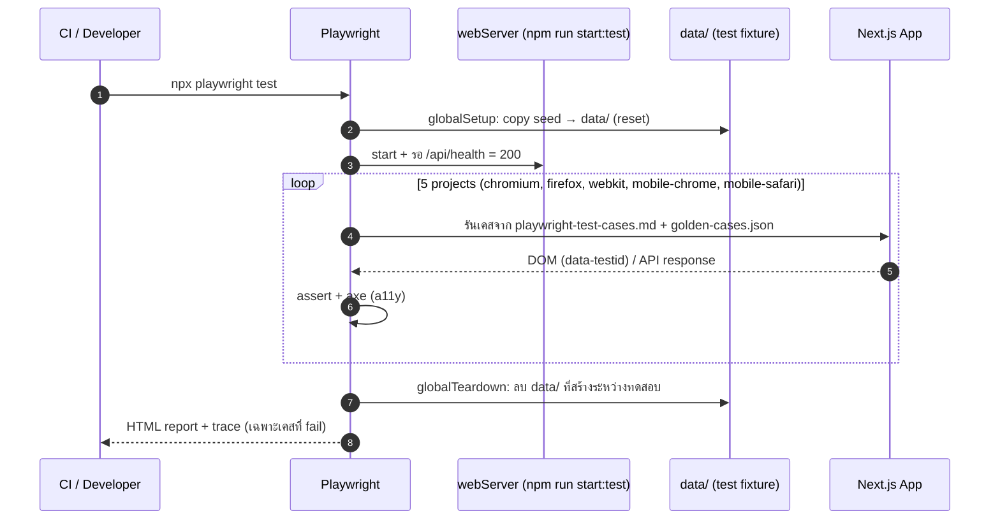

# Sequence Diagrams

## 1. วิเคราะห์เบอร์โทรศัพท์ — `POST /api/v1/phone/analyze`

## 2. วิเคราะห์ทะเบียนรถ — `POST /api/v1/plate/analyze`

## 3. Admin Login

## 4. Draft → Preview → Approve → Publish

## 5. Rollback

## 6. Playwright E2E — การรันทดสอบ

