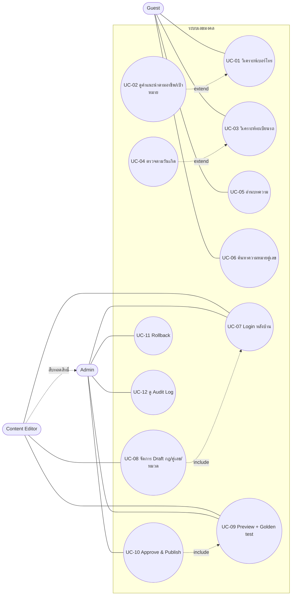

# Use Case — ระบบเลขมงคลและทะเบียนรถมงคล (MVP)

## 1. Use Case Diagram

> Admin มีสิทธิ์ทุกอย่างของ Editor (UC-08) แต่ **Approve งานที่ตัวเองสร้างไม่ได้** (BR-AD-01)

## 2. Use Case Specifications

### UC-01 วิเคราะห์เบอร์โทรศัพท์
| หัวข้อ | รายละเอียด |
| --- | --- |
| Actor | Guest |
| Stories / FR | US-PH-001, 002 · FR-PH-01–07 |
| Precondition | Rule Set เบอร์อยู่ในสถานะ Published |
| Main flow | 1) กรอกเบอร์ → 2) ระบบ Normalize (BR-PH-01–03) → 3) Validate (BR-PH-04) → 4) แยก 6 คู่ ตำแหน่ง 4–10 (BR-PH-05) → 5) Lookup ความหมาย → 6) แสดงผล + Rule Set/เวอร์ชัน + Disclaimer + ป้าย Mock |
| Alternate | 2a) เลือกอาชีพ/เป้าหมาย → UC-02 |
| Exception | 3a) ไม่ผ่าน → แสดง Error Code §5.3 และ focus ที่ input · 5a) คู่ไม่มีข้อมูล → `no-data` · E1) Rate limit → 429 · E2) โหลดกฎไม่ได้ → `INTERNAL_ERROR` |
| Postcondition | ไม่เก็บเบอร์; Stats `phone` +1 |

### UC-02 คำแนะนำตามอาชีพ/เป้าหมาย (extend UC-01)
| หัวข้อ | รายละเอียด |
| --- | --- |
| Stories / FR | US-PH-004 · FR-PH-08–09 |
| Main flow | เลือกอาชีพ/เป้าหมายที่ `enabled` → ระบบหาคู่แนะนำตามกฎ → แสดงเหตุผล |
| Exception | ไม่มีกฎของอาชีพนั้น → แสดงผลทั่วไป + ข้อความแจ้ง · ค่าไม่อยู่ในรายการ → `INVALID_OPTION` |

### UC-03 วิเคราะห์ทะเบียนรถ
| หัวข้อ | รายละเอียด |
| --- | --- |
| Actor | Guest |
| Stories / FR | US-LP-001, 003, 004, 005 · FR-LP-01–06, 09–11 |
| Main flow | 1) กรอกเลขนำหน้า/อักษร/ตัวเลข/จังหวัด → 2) Parse + Validate (BR-LP-01–04) → 3) คำนวณผลรวม 2 แบบ (BR-LP-05–07) → 4) แยกคู่ + ใช้ precedence (BR-LP-09) → 5) ตรวจรูปแบบ → 6) แสดงผล + ข้อความ "ไม่ได้ยืนยันสถานะทะเบียน" |
| Alternate | 1a) เลือกวันเกิด → UC-04 |
| Exception | 2a) ไม่ผ่าน → `PLATE_*` error · 4a) ตัวเลข 1 หลัก → "ไม่มีคู่เลขให้วิเคราะห์" |
| Postcondition | ไม่เก็บทะเบียน; Stats `plate` +1 |

### UC-04 ตรวจตามวันเกิด (extend UC-03)
| หัวข้อ | รายละเอียด |
| --- | --- |
| Stories / FR | US-LP-002, 004 · FR-LP-07–08 |
| Main flow | เลือก 1 ใน 8 วัน → แสดงเลขส่งเสริม → Highlight เลขเลี่ยง (Wongnai) และอักษรเลี่ยง (Allianz) พร้อมแหล่ง |
| Rule | เปลี่ยนวันเกิดแล้วผลรวม/คู่เลขต้องไม่เปลี่ยน |

### UC-05 อ่านบทความ
| Stories / FR | US-CT-001 · FR-CT-01–03 |
| --- | --- |
| Main flow | ดูรายการ → กรองหมวด / ค้นหา → เปิดบทความ (ผู้เขียน วันที่ แหล่งอ้างอิง) |
| Exception | ไม่พบ → Empty state · slug ไม่มี → 404 · คำค้น > 100 ตัวอักษร → `QUERY_TOO_LONG` |

### UC-06 ค้นหาความหมายคู่เลข
| Stories / FR | US-CT-002 · FR-CT-04 |
| --- | --- |
| Main flow | กรอกเลข 2 หลัก → คืนผลของกลุ่ม (24 = 42) พร้อมชื่อ Rule Set |
| Exception | ไม่ใช่ 2 หลัก → `PAIR_INVALID` · ไม่มีในกฎ → `ไม่มีข้อมูล` |

### UC-07 Login หลังบ้าน
| Stories / FR | FR-AD-01 · NFR-05–07 |
| --- | --- |
| Main flow | กรอก username/password → ตรวจ hash → สร้าง session cookie → redirect ตาม Role |
| Exception | ผิด → `AUTH_INVALID` (ไม่บอกว่าผิดช่องไหน) · ผิดครบ 5 ครั้ง → `AUTH_LOCKED` 15 นาที · Idle 30 นาที → session หมดอายุ |

### UC-08 จัดการ Draft
| Actor | Content Editor, Admin |
| --- | --- |
| Stories / FR | US-AD-001, 003 · FR-AD-02, 07, 08 |
| Main flow | สร้าง/แก้ความหมายคู่เลข / กฎ / หมวด → Validate (BR-AD-03–04) → บันทึกเป็น Draft → Audit `DRAFT_SAVED` |
| Exception | คู่ซ้ำ → `PAIR_DUPLICATE` · ไม่มีแหล่ง → `SOURCE_REQUIRED` · หมวดผูกกฎที่ไม่มี → `INVALID_OPTION` |

### UC-09 Preview + Golden test
| Actor | Editor, Admin |
| --- | --- |
| FR / ADR | FR-AD-03 · ADR-005 |
| Main flow | เลือก Draft → ระบบรัน `golden-cases.json` + input ทดสอบที่ผู้ใช้กรอก กับ Draft → แสดงผลและ Diff กับเวอร์ชัน Published |

### UC-10 Approve & Publish
| Actor | Admin |
| --- | --- |
| Stories / FR | US-AD-002 · FR-AD-03–04, 06 · BR-AD-01–02 |
| Precondition | Draft ผ่าน UC-09 แล้ว; ผู้ Approve ≠ ผู้สร้าง |
| Main flow | Approve → Publish → สร้างเวอร์ชันใหม่ (immutable) → Audit → สลับตัวชี้ Published |
| Exception | ผู้สร้าง Approve เอง → `FORBIDDEN_SELF_APPROVE` · มีคนอื่น Publish ก่อน → `VERSION_CONFLICT` (409) · Golden เปลี่ยนผล → ต้องยืนยัน Diff |

### UC-11 Rollback
| Actor | Admin |
| --- | --- |
| Stories / FR | US-AD-005 · FR-AD-05 |
| Main flow | เลือกเวอร์ชันเก่า → ระบบสร้างเวอร์ชันใหม่จากเนื้อหาเดิม → Audit `ROLLBACK` → สลับตัวชี้ |
| Rule | ประวัติเดิมต้องไม่ถูกลบ |

### UC-12 ดู Audit Log
| Actor | Admin |
| --- | --- |
| FR / NFR | FR-AD-06 · NFR-13 |
| Main flow | กรองตามผู้ทำ / การกระทำ / ช่วงเวลา → ดูค่าเดิมและค่าใหม่ |
| Rule | อ่านอย่างเดียว ไม่มีปุ่มแก้หรือลบ |

## 3. Traceability

| Use Case | Stories | Playwright |
| --- | --- | --- |
| UC-01 | PH-001, PH-002 | PH-001–025, PR-001–015 |
| UC-02 | PH-004 | OC-001–008 |
| UC-03 | LP-001, 003, 004, 005 | LP-001–020, SM-001–012, PP-001–009 |
| UC-04 | LP-002, 004 | BD-001–013 |
| UC-05 | CT-001 | AR-001–009 |
| UC-06 | CT-002 | PS-001–011 |
| UC-07 | AD-001 | AD-001–003, AD-020 |
| UC-08 | AD-001, 003 | AD-004, AD-013–019 |
| UC-09 / UC-10 | AD-002 | AD-005–009 |
| UC-11 / UC-12 | AD-005 | AD-010–012 |
