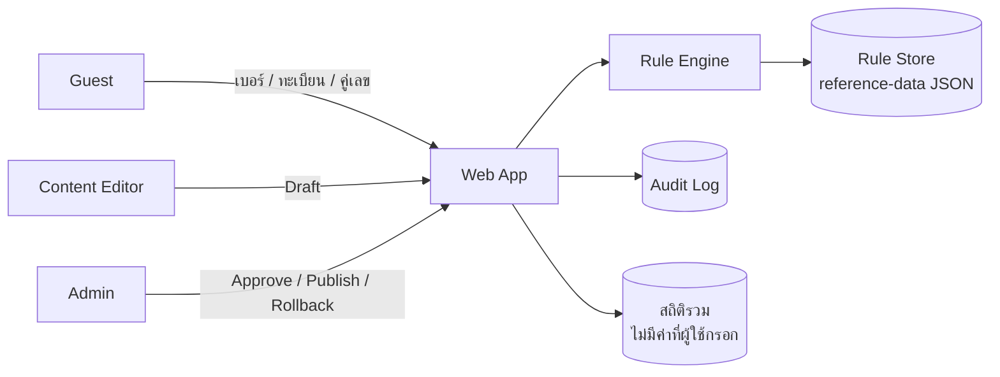
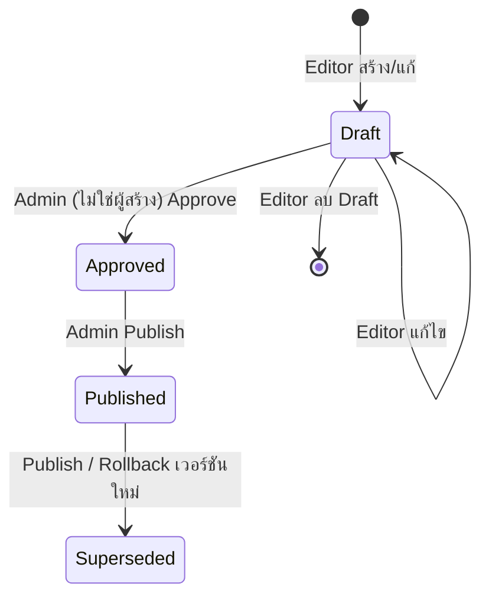

# System Requirements Specification — ระบบเลขมงคลและทะเบียนรถมงคล (MVP Phase 1)

> **Version:** 1.0 · **Status:** Accepted (Demo) · **Date:** 2026-11-06
> **ที่มา:** [User Stories v1.3](../user-story/numerology-user-stories-review.md) · [Reference Data](../user-story/reference-data/README.md) · [Playwright Test Cases](../user-story/test-cases/playwright-test-cases.md)
> **ขอบเขต:** 14 Stories ใน MVP — US-PH-001/002/004, US-LP-001–005, US-CT-001/002, US-AD-001/002/003/005
> **คำศัพท์:** "ต้อง" = บังคับ (ทดสอบได้) · "ควร" = ทางเลือก (Optional)

---

## 1. Actors & System Boundary

| Actor | ประเภท | สิทธิ์ |
| --- | --- | --- |
| Guest | ผู้ใช้ไม่ Login | วิเคราะห์เบอร์/ทะเบียน อ่านบทความ ค้นหาคู่เลข |
| Content Editor | ผู้ใช้หลังบ้าน | สร้าง/แก้ Draft ของ Rule, ความหมายคู่เลข, หมวด |
| Admin | ผู้ใช้หลังบ้าน | ทุกสิทธิ์ของ Editor + Approve, Publish, Rollback, ดู Audit Log |
| Rule Store | ระบบภายใน | ไฟล์ JSON ใน `reference-data/` (MVP ไม่มีฐานข้อมูลจริง) |

**นอกขอบเขต:** สมาชิก, รีวิว, Marketplace, คะแนน 0–100, การตรวจสถานะทะเบียนกับกรมการขนส่งทางบก, ระบบชำระเงิน



---

## 2. Functional Requirements (FR)

### 2.1 วิเคราะห์เบอร์โทรศัพท์ (US-PH-001, 002, 004)

| ID | Requirement | Story | Test |
| --- | --- | --- | --- |
| FR-PH-01 | ระบบต้องรับเบอร์มือถือและ Normalize ตาม BR-PH-01 ถึง BR-PH-03 ก่อนตรวจสอบ | PH-001 | PH-004–008 |
| FR-PH-02 | ระบบต้องปฏิเสธเบอร์ที่ไม่ผ่าน BR-PH-04 และคืน Error Code ตาม §5 | PH-001 | PH-009–017 |
| FR-PH-03 | ระบบต้องวิเคราะห์ได้โดยไม่ต้อง Login | PH-001 | PH-022 |
| FR-PH-04 | ระบบต้องแยกคู่เลขติดกันจากตำแหน่ง 4–10 (ไม่ดู 3 หลักแรก) ได้ **6 คู่** ตามลำดับ (BR-PH-05) | PH-002 | PR-001–009 |
| FR-PH-05 | ระบบต้องแสดงคู่เลข, ตำแหน่ง, ระดับ (`good`/`caution`/`avoid`/`no-data`), ความหมาย, ข้อดี, ข้อเสีย และหมวดของแต่ละคู่ | PH-002 | PR-010–014 |
| FR-PH-06 | ถ้าคู่เลขไม่มีใน Rule Set ระบบต้องแสดง `ไม่มีข้อมูล` และห้ามสร้างคำทำนายเอง | PH-002 | PR-012 |
| FR-PH-07 | ระบบต้องแสดงชื่อ Rule Set, เวอร์ชัน และแหล่งอ้างอิงในทุกผลลัพธ์ | PH-001 | PH-020 |
| FR-PH-08 | ผู้ใช้ต้องเลือกอาชีพและเป้าหมายได้ (ไม่บังคับ) จากรายการที่เปิดใช้งาน | PH-004 | OC-001–002 |
| FR-PH-09 | เมื่อเลือกอาชีพ/เป้าหมาย ระบบต้องแสดงคู่เลขแนะนำพร้อมเหตุผล ถ้าไม่มีกฎของอาชีพนั้น ต้องแสดงผลวิเคราะห์ทั่วไปพร้อมข้อความแจ้ง | PH-004 | OC-003–007 |

### 2.2 วิเคราะห์ทะเบียนรถ (US-LP-001 ถึง 005)

| ID | Requirement | Story | Test |
| --- | --- | --- | --- |
| FR-LP-01 | ระบบต้องรับเลขนำหน้า (ไม่บังคับ), หมวดอักษร, ตัวเลข และจังหวัด (ไม่บังคับ) | LP-001 | LP-001–006 |
| FR-LP-02 | ระบบต้องปฏิเสธทะเบียนที่ไม่ผ่าน BR-LP-01 ถึง BR-LP-04 พร้อมบอกรูปแบบที่รองรับ | LP-001 | LP-007–014 |
| FR-LP-03 | ระบบต้องวิเคราะห์ได้โดยไม่ต้อง Login | LP-001 | LP-018 |
| FR-LP-04 | ระบบต้องคำนวณผลรวม **2 แบบพร้อมกัน**: (1) เฉพาะตัวเลข (2) รวมค่าอักษร ตาม BR-LP-05 ถึง BR-LP-07 | LP-003 | SM-001–008 |
| FR-LP-05 | ระบบต้องแสดงสูตรการบวกทีละตัว และค่าที่แปลงของแต่ละอักษร | LP-003 | SM-009–010 |
| FR-LP-06 | ระบบต้องแสดงระดับของผลรวมแต่ละแบบตาม `sumGrades` ถ้าไม่มี ต้องแสดง `ไม่มีข้อมูล` | LP-003 | SM-001–008 |
| FR-LP-07 | ผู้ใช้ต้องเลือกวันเกิดได้ 8 ค่า (พุธแยกกลางวัน/กลางคืน) และไม่บังคับเลือก | LP-002 | BD-010–011 |
| FR-LP-08 | เมื่อเลือกวันเกิด ระบบต้องแสดงเลขส่งเสริม และ Highlight เลข/อักษรที่ควรเลี่ยง พร้อมเหตุผลและแหล่ง (BR-LP-08) | LP-002, LP-004 | BD-001–009 |
| FR-LP-09 | ระบบต้องแยกคู่เลขติดกันของส่วนตัวเลข (ไม่รวมเลขนำหน้า) และแสดงระดับตาม BR-LP-09 | LP-005 | PP-001–007 |
| FR-LP-10 | ระบบต้องตรวจรูปแบบควรเลี่ยง (`one-bracket`, `front-back-13`) และแสดงคำเตือน | LP-004 | PP-004–005 |
| FR-LP-11 | ทุกผลลัพธ์ต้องแสดงข้อความ "ไม่ได้ยืนยันสถานะทะเบียน" และ "เป็นความเชื่อ ไม่ใช่ข้อห้ามตามกฎหมาย" | LP-001, LP-004 | LP-017, BD-013 |
| FR-LP-12 | (CR 2026-11-07) เมื่อเลือก **วันเกิดอย่างเดียว** (ไม่กรอกเลขนำหน้า/ตัวเลข) ระบบต้องเสนอเลขทะเบียน 2–4 หลัก ≤ 8 เลข ที่: ใช้เฉพาะเลขส่งเสริมของวัน · ไม่มีคู่ควรเลี่ยง/ควรระวัง · ไม่ตรงรูปแบบควรเลี่ยง · ผลรวมระดับ excellent (ถ้ากรอกหมวดอักษร ใช้ผลรวมรวมค่าอักษร และเตือนอักษรที่ควรเลี่ยงของวัน) · หมวดอักษรไม่บังคับ · เรียงตามจำนวนคู่ดี → ความยาว → ตัวเลข · ไม่มีผล → แสดงข้อความ | — | — |

### 2.3 Knowledge Base (US-CT-001, 002)

| ID | Requirement | Story | Test |
| --- | --- | --- | --- |
| FR-CT-01 | ระบบต้องแสดงรายการบทความ (Static Markdown) พร้อมกรองตามหมวดและค้นหาจากชื่อ/เนื้อหา | CT-001 | AR-001–006 |
| FR-CT-02 | หน้าบทความต้องแสดงผู้เขียน, วันที่ปรับปรุง, แหล่งอ้างอิง, `<title>` และ meta description | CT-001 | AR-003, AR-008 |
| FR-CT-03 | Slug ที่ไม่มีอยู่ต้องได้หน้า 404 | CT-001 | AR-007 |
| FR-CT-04 | ระบบต้องค้นหาความหมายคู่เลข 2 หลัก โดยคืนผลของทั้งกลุ่ม (เช่น 24 และ 42 ได้ผลเดียวกัน) | CT-002 | PS-001–006 |

### 2.4 Admin & Rule Management (US-AD-001, 002, 003, 005)

| ID | Requirement | Story | Test |
| --- | --- | --- | --- |
| FR-AD-01 | หน้า `/admin/*` ต้องเข้าได้เฉพาะผู้ที่ Login แล้ว และมี Role เป็น Editor หรือ Admin | AD-001 | AD-001, AD-020 |
| FR-AD-02 | Editor ต้องสร้าง/แก้ความหมายคู่เลข, กฎ และหมวด (อาชีพ/เป้าหมาย) ได้ในสถานะ Draft | AD-001, 003 | AD-004, AD-016 |
| FR-AD-03 | Admin ต้องดู Diff, Preview ผลกับข้อมูลทดสอบ, Approve และ Publish ได้ | AD-002 | AD-006–008 |
| FR-AD-04 | เมื่อ Publish ระบบต้องสร้างเวอร์ชันใหม่ และผลวิเคราะห์ใหม่ทุกครั้งต้องใช้เวอร์ชันนั้น | AD-002 | AD-008–009 |
| FR-AD-05 | Admin ต้อง Rollback ไปเวอร์ชันก่อนหน้าได้ โดยสร้างเวอร์ชันใหม่ และไม่ลบประวัติเดิม | AD-005 | AD-010, AD-012 |
| FR-AD-06 | ทุกการ Create/Update/Approve/Publish/Rollback ต้องบันทึก Audit Log | AD-005 | AD-011 |
| FR-AD-07 | ระบบต้องตรวจความซ้ำและความครบของข้อมูลตาม BR-AD-03 และ BR-AD-04 ก่อนบันทึก | AD-001 | AD-013–015 |
| FR-AD-08 | Admin ต้องเปิด/ปิดการใช้งานหมวดได้ และหมวดที่ปิดต้องไม่แสดงต่อผู้ใช้ | AD-003 | AD-017 |

---

## 3. Business Rules (BR)

### 3.1 เบอร์โทรศัพท์

| ID | Rule |
| --- | --- |
| BR-PH-01 | ตัดช่องว่างหน้า/หลัง และลบ `-` กับช่องว่างภายในก่อนตรวจสอบ |
| BR-PH-02 | แปลงเลขไทย `๐–๙` เป็น `0–9` |
| BR-PH-03 | `+66XXXXXXXXX` และ `66XXXXXXXXX` (9 หลักหลังรหัส) แปลงเป็น `0XXXXXXXXX` |
| BR-PH-04 | หลัง Normalize ต้องเป็นตัวเลข **10 หลักพอดี** และขึ้นต้นด้วย `06`, `08` หรือ `09` |
| BR-PH-05 | คู่เลข = `d[i]d[i+1]` สำหรับ i = 4..9 (นับหลักแรก = 1) → 6 คู่ (ไม่ดู 3 หลักแรก — CR 2026-11-07) คู่ซ้ำแสดงทุกตำแหน่ง |
| BR-PH-06 | ระดับคู่เลขอ่านจาก `pair-meanings.json` คู่ที่ไม่มี = `no-data` |

### 3.2 ทะเบียนรถ

| ID | Rule |
| --- | --- |
| BR-LP-01 | รูปแบบ: `[เลขนำหน้า 0–1 หลัก][พยัญชนะไทย 1–2 ตัว][ตัวเลข 1–4 หลัก]` คั่นด้วยช่องว่างหรือ `-` ได้ |
| BR-LP-02 | เลขนำหน้า (ถ้ามี) ต้องเป็น `1–9` |
| BR-LP-03 | หมวดอักษรรับเฉพาะพยัญชนะไทย 44 ตัว (ไม่รับสระ วรรณยุกต์ หรือตัวอักษรอังกฤษ) |
| BR-LP-04 | ตัวเลขต้องมีค่า `1–9999` และ**ไม่ขึ้นต้นด้วย 0** |
| BR-LP-05 | ผลรวมเฉพาะตัวเลข = ผลบวกของเลขนำหน้า + ทุกหลักของตัวเลข |
| BR-LP-06 | ผลรวมรวมอักษร = ผลรวมเฉพาะตัวเลข + ค่าอักษรตาม `letterValues` (ทักษา, ฎ ฏ ฐ = 9) |
| BR-LP-07 | ไม่ลดเหลือหลักเดียวโดยค่าเริ่มต้น (ตีความผลรวม 2 หลักตาม `plate-wongnai-v1`) |
| BR-LP-08 | เลขดี/เลขเลี่ยงตามวันเกิดใช้ `plate-wongnai-v1`; อักษรเลี่ยงใช้ `plate-allianz-v1.avoidLetters` และต้องระบุแหล่งแยกกัน |
| BR-LP-09 | ลำดับความสำคัญของระดับคู่เลข: `avoidPairs` > `avoidPatterns` > `occupationPairs` > ความหมายทั่วไป; คู่ 35/53 = `caution` และห้ามใช้เป็นเลขแนะนำ |
| BR-LP-10 | จังหวัดไม่มีผลต่อการคำนวณใดๆ |

### 3.3 Admin, เนื้อหา และ Compliance

| ID | Rule |
| --- | --- |
| BR-AD-01 | Workflow 2 ขั้น: Editor สร้าง Draft → Admin Approve/Publish — **ผู้สร้างห้าม Approve งานของตนเอง** |
| BR-AD-02 | สถานะ Rule: `Draft → Approved → Published → Superseded`; Rollback = สร้างเวอร์ชันใหม่จากเวอร์ชันเก่า |
| BR-AD-03 | คู่เลขต้องไม่ซ้ำภายใน Rule Set เดียวกัน (นับ 24 และ 42 เป็นกลุ่มเดียวกันได้) |
| BR-AD-04 | ความหมายคู่เลขต้องมี `source` ทุกครั้ง |
| BR-CM-01 | ห้ามใช้คำ "แม่นที่สุด", "รับประกัน", "พิสูจน์แล้ว" ในหน้าใดของระบบ |
| BR-CM-02 | ข้อมูลที่ `status` เป็น `mock` ต้องแสดงป้าย "ข้อมูลตัวอย่าง" |
| BR-PV-01 | ห้ามเก็บเบอร์/ทะเบียนที่ Guest กรอก; เก็บได้เฉพาะสถิติรวม (จำนวนครั้ง, ประเภทการวิเคราะห์) |



---

## 4. ค่าขอบ (Boundary Values)

### 4.1 เบอร์โทรศัพท์

| ค่า | Input | ผล | Error Code |
| --- | --- | --- | --- |
| ความยาว 9 หลัก | `081234567` | ❌ | `PHONE_INVALID_LENGTH` |
| ความยาว 10 หลัก | `0812345678` | ✅ | — |
| ความยาว 11 หลัก | `08123456789` | ❌ | `PHONE_INVALID_LENGTH` |
| `+66` + 8 หลัก | `+6681234567` | ❌ | `PHONE_INVALID_LENGTH` |
| `+66` + 9 หลัก | `+66812345678` | ✅ | — |
| `+66` + 10 หลัก | `+668123456789` | ❌ | `PHONE_INVALID_LENGTH` |
| Prefix `05` | `0512345678` | ❌ | `PHONE_NOT_MOBILE` |
| Prefix `06` (ขอบล่าง) | `0612345678` | ✅ | — |
| Prefix `07` | `0712345678` | ❌ | `PHONE_NOT_MOBILE` |
| Prefix `08` | `0812345678` | ✅ | — |
| Prefix `09` (ขอบบน) | `0912345678` | ✅ | — |
| ว่าง | `` | ❌ | `PHONE_REQUIRED` |
| ความยาวดิบเกิน | > 20 ตัวอักษรก่อน Normalize | ❌ | `PHONE_INVALID_LENGTH` |
| ทุกหลักเป็น 0 หลัง prefix | `0800000000` | ✅ (คู่ 00 = avoid ×7) | — |

### 4.2 ทะเบียนรถ

| ส่วน | ต่ำกว่าขอบ | ขอบล่าง | ขอบบน | เกินขอบ |
| --- | --- | --- | --- | --- |
| เลขนำหน้า | `0กข 1` ❌ `PLATE_INVALID_PREFIX` | ไม่มี ✅ / `1` ✅ | `9` ✅ | `10กข 1` ❌ `PLATE_INVALID_FORMAT` |
| หมวดอักษร | 0 ตัว ❌ `PLATE_LETTERS_REQUIRED` | 1 ตัว `ก 1` ✅ | 2 ตัว `กข 1` ✅ | 3 ตัว `กขค 1` ❌ `PLATE_INVALID_FORMAT` |
| ตัวเลข (หลัก) | 0 หลัก ❌ `PLATE_DIGITS_REQUIRED` | 1 หลัก `กข 1` ✅ | 4 หลัก `กข 9999` ✅ | 5 หลัก `กข 10000` ❌ `PLATE_INVALID_FORMAT` |
| ตัวเลข (ค่า) | `0` / `0123` ❌ `PLATE_LEADING_ZERO` | `1` ✅ | `9999` ✅ | — |

### 4.3 ช่วงของผลลัพธ์ (Output Range)

| Output | ต่ำสุด | ตัวอย่าง | สูงสุด | ตัวอย่าง |
| --- | --- | --- | --- | --- |
| ผลรวมเฉพาะตัวเลข | 1 | `ก 1` | 45 | `9ฆฆ 9999` (9 + 36) |
| ผลรวมรวมอักษร | 2 | `ก 1` (1 + ก=1) | 63 | `9ฎฎ 9999` (45 + 9 + 9) |
| จำนวนคู่เลขทะเบียน | 0 | `กข 7` | 3 | `กข 1234` |
| จำนวนคู่เลขเบอร์ | 8 | ทุกเบอร์ที่ผ่าน | 8 | ทุกเบอร์ที่ผ่าน |
| เลขที่ Highlight | 0 | — | 5 | เลขนำหน้า + 4 หลัก |
| อักษรที่ Highlight | 0 | — | 2 | — |

### 4.4 อื่นๆ

| รายการ | ขอบล่าง | ขอบบน | เกินขอบ → Error |
| --- | --- | --- | --- |
| ค้นหาคู่เลข | `00` | `99` | 1 หลัก / 3 หลัก / ไม่ใช่ตัวเลข → `PAIR_INVALID` |
| คำค้นบทความ | 1 ตัวอักษร | 100 ตัวอักษร | 0 → แสดงทั้งหมด, > 100 → `QUERY_TOO_LONG` |
| ความหมายคู่เลข (Admin) | 1 ตัวอักษร | 500 ตัวอักษร | `VALIDATION_LENGTH` |
| แหล่งอ้างอิง (Admin) | 1 ตัวอักษร | 255 ตัวอักษร | ว่าง → `SOURCE_REQUIRED` |
| Rate limit วิเคราะห์ | 30 ครั้ง/นาที/IP ✅ | — | ครั้งที่ 31 → `RATE_LIMITED` (429) |
| Login ผิดติดกัน | 4 ครั้ง ✅ ยังลองได้ | 5 ครั้ง → ล็อก 15 นาที | `AUTH_LOCKED` |
| Session Admin | — | Idle 30 นาที | หมดอายุ → redirect Login |

---

## 5. Output Specification

### 5.1 `POST /api/v1/phone/analyze`

**Request**
```json
{ "number": "081-234-5678", "occupation": "trade", "goal": "money" }
```
`occupation`, `goal` = Optional และต้องเป็นค่าที่เปิดใช้งาน

**Response 200**
```json
{
  "success": true,
  "data": {
    "normalized": "0812345678",
    "ruleSet": { "id": "pairs-common-belief-mock", "version": "0.1.0-mock", "source": "...", "isMock": true },
    "pairs": [
      { "position": "4-5", "pair": "23", "grade": "good", "categories": [], "pros": "…", "cons": null },
      { "position": "4-5", "pair": "34", "grade": "no-data", "categories": [], "pros": null, "cons": null }
    ],
    "recommendation": { "occupation": "trade", "matchedRule": true, "pairs": ["24", "42"], "reason": "..." },
    "disclaimer": "ผลลัพธ์ตามความเชื่อ ไม่ใช่ข้อเท็จจริงทางวิทยาศาสตร์"
  },
  "error": null
}
```

### 5.2 `POST /api/v1/plate/analyze`

**Request**
```json
{ "prefix": "1", "letters": "กข", "digits": "5900", "province": "กรุงเทพมหานคร", "birthDay": "sun" }
```
`birthDay` ∈ `sun | mon | tue | wed-day | wed-night | thu | fri | sat` (Optional)

**Response 200**
```json
{
  "success": true,
  "data": {
    "plate": { "prefix": "1", "letters": [{ "char": "ก", "value": 1 }, { "char": "ข", "value": 2 }], "digits": "5900" },
    "ruleSets": [{ "id": "plate-wongnai-v1", "version": "1.0.0-draft" }, { "id": "plate-allianz-v1", "usedFor": "avoidLetters" }],
    "sums": [
      { "method": "digits-only", "terms": [1, 5, 9, 0, 0], "total": 15, "grade": "excellent", "meaning": "มีเสน่ห์ การงานมั่นคง" },
      { "method": "with-letters", "terms": [1, 5, 9, 0, 0, 1, 2], "total": 18, "grade": "no-data", "meaning": null }
    ],
    "pairs": [
      { "pair": "59", "grade": "good" }, { "pair": "90", "grade": "no-data" }, { "pair": "00", "grade": "avoid", "reason": "เชื่อว่ารถซ่อมบ่อย" }
    ],
    "patterns": [],
    "birthDay": {
      "day": "sun", "luckyDigits": [1, 8, 9],
      "highlightDigits": [],
      "highlightLetters": [{ "char": "ข", "source": "plate-allianz-v1" }]
    },
    "notices": ["ไม่ได้ยืนยันสถานะทะเบียน", "เป็นความเชื่อ ไม่ใช่ข้อห้ามตามกฎหมาย"]
  },
  "error": null
}
```

### 5.3 Error Response (ทุก Endpoint)

```json
{ "success": false, "data": null, "error": { "code": "PHONE_NOT_MOBILE", "message": "รองรับเฉพาะเบอร์มือถือ", "field": "number" } }
```

| Code | HTTP | ข้อความ (แสดงผู้ใช้) |
| --- | --- | --- |
| `PHONE_REQUIRED` | 400 | กรุณากรอกเบอร์มือถือ |
| `PHONE_INVALID_LENGTH` | 400 | กรุณากรอกเบอร์มือถือ 10 หลัก |
| `PHONE_INVALID_CHAR` | 400 | กรุณากรอกเบอร์มือถือ 10 หลัก |
| `PHONE_NOT_MOBILE` | 400 | รองรับเฉพาะเบอร์มือถือ |
| `PLATE_INVALID_FORMAT` | 400 | รองรับรูปแบบ [เลข 1 หลัก] [พยัญชนะไทย 1–2 ตัว] [เลข 1–4 หลัก] |
| `PLATE_INVALID_PREFIX` | 400 | เลขนำหน้าต้องเป็น 1–9 |
| `PLATE_LETTERS_REQUIRED` | 400 | กรุณากรอกหมวดอักษร |
| `PLATE_INVALID_LETTER` | 400 | รองรับเฉพาะพยัญชนะไทย |
| `PLATE_DIGITS_REQUIRED` | 400 | กรุณากรอกตัวเลขทะเบียน |
| `PLATE_LEADING_ZERO` | 400 | ตัวเลขทะเบียนต้องไม่ขึ้นต้นด้วย 0 |
| `INVALID_OPTION` | 400 | ตัวเลือกไม่ถูกต้อง (อาชีพ/เป้าหมาย/วันเกิด) |
| `PAIR_INVALID` | 400 | กรุณากรอกเลข 2 หลัก |
| `QUERY_TOO_LONG` | 400 | คำค้นยาวเกิน 100 ตัวอักษร |
| `SOURCE_REQUIRED` | 400 | กรุณาระบุแหล่งอ้างอิง |
| `PAIR_DUPLICATE` | 409 | มีคู่เลขนี้แล้ว |
| `UNAUTHENTICATED` | 401 | กรุณาเข้าสู่ระบบ |
| `AUTH_INVALID` | 401 | ชื่อผู้ใช้หรือรหัสผ่านไม่ถูกต้อง |
| `AUTH_LOCKED` | 423 | บัญชีถูกล็อกชั่วคราว กรุณาลองใหม่ใน 15 นาที |
| `FORBIDDEN_SELF_APPROVE` | 403 | ไม่สามารถอนุมัติงานของตนเองได้ |
| `FORBIDDEN` | 403 | ไม่มีสิทธิ์ดำเนินการ |
| `RATE_LIMITED` | 429 | ใช้งานถี่เกินไป กรุณาลองใหม่ภายหลัง |
| `INTERNAL_ERROR` | 500 | ระบบขัดข้อง กรุณาลองใหม่ (ห้ามส่ง Stack trace) |

---

## 6. Non-Functional Requirements (NFR)

| ID | หมวด | Requirement | วิธีตรวจ |
| --- | --- | --- | --- |
| NFR-01 | Performance | API วิเคราะห์ตอบภายใน **500 ms ที่ p95** ภายใต้ 50 ผู้ใช้พร้อมกัน | k6 50 VUs, 5 นาที |
| NFR-02 | Performance | หน้า `/phone`, `/plate` มี LCP ≤ **2.5 วินาที** บน Mobile 4G | Lighthouse |
| NFR-03 | Correctness | Rule Engine ต้อง Deterministic: input + เวอร์ชันกฎเดียวกัน → output เหมือนกัน 100% | Golden Tests (`golden-cases.json`) ผ่านทุกเคส |
| NFR-04 | Correctness | ทุกการแก้ Rule ต้องรัน Regression Golden Tests ก่อน Publish | CI |
| NFR-05 | Security | `/admin/*` ใช้ RBAC (Editor, Admin) และตรวจสิทธิ์ฝั่ง Server ทุก Request | AD-001, AD-005 |
| NFR-06 | Security | รหัสผ่านเก็บแบบ Hash (bcrypt/argon2) และล็อกหลังผิด 5 ครั้งเป็นเวลา 15 นาที | Unit + E2E |
| NFR-07 | Security | Rate limit 30 ครั้ง/นาที/IP สำหรับ API วิเคราะห์ และ 10 ครั้ง/นาที/IP สำหรับ Login | SC-002 |
| NFR-08 | Security | Validate input ฝั่ง Server ทุกฟิลด์, Escape output ทุกจุด, มี CSP และ `X-Content-Type-Options` | SC-001, SC-003 |
| NFR-09 | Security | Error response ห้ามมี Stack trace หรือรายละเอียดภายใน | SC-004 |
| NFR-10 | Privacy | ห้ามส่งเบอร์/ทะเบียนผ่าน URL (ใช้ POST body) และห้ามเก็บใน Storage ฝั่ง Browser | PV-001–004 |
| NFR-11 | Privacy | Log ต้อง Mask ค่า เช่น `081****678`, `กข **00` | ตรวจ Log |
| NFR-12 | Privacy | ห้ามส่งค่าที่ผู้ใช้กรอกไปยัง Analytics ภายนอก | PV-005 |
| NFR-13 | Audit | Audit Log เก็บ ผู้ทำ, Role, การกระทำ, เวลา (UTC), ค่าเดิม/ค่าใหม่ และห้ามแก้หรือลบ | AD-011–012 |
| NFR-14 | Accessibility | WCAG 2.2 AA — axe ไม่มี violation ระดับ serious/critical | A11Y-001–006 |
| NFR-15 | Accessibility | ทุกฟอร์มใช้ได้ด้วยคีย์บอร์ดอย่างเดียว และ error ผูกกับ input (`aria-describedby`) | A11Y-004–005 |
| NFR-16 | Compatibility | รองรับ Chrome, Firefox, Safari รุ่นล่าสุด 2 รุ่น และจอกว้าง 360 px ขึ้นไปโดยไม่มี Scroll แนวนอน | Playwright 5 Projects, MB-001 |
| NFR-17 | Usability | ข้อความ Error ทั้งหมดเป็นภาษาไทยตาม §5.3 | E2E |
| NFR-18 | Observability | API ต้องมี Request ID ในทุก Response และ Log, มี Error monitoring | ตรวจ Header `X-Request-Id` |
| NFR-19 | Availability | Demo: ไม่กำหนด SLA — ถ้าโหลด Rule Store ไม่ได้ ต้องแสดง `INTERNAL_ERROR` ห้ามแสดงผลที่ไม่มีกฎรองรับ | Mock failure |
| NFR-20 | Compliance | ทุกหน้าผลลัพธ์มี Disclaimer และป้าย "ข้อมูลตัวอย่าง" เมื่อใช้ Mock | CP-001–003 |

---

## 7. Data Requirements (Logical)

| Entity | Attribute หลัก | กฎ |
| --- | --- | --- |
| RuleSet | `ruleSetId`, `version`, `status`, `source`, `effectiveAt`, `createdBy`, `approvedBy` | `approvedBy ≠ createdBy`; มี `Published` ได้ครั้งละ 1 เวอร์ชันต่อ `ruleSetId` |
| PairMeaning | `pairs[]`, `grade`, `categories[]`, `pros`, `cons`, `source` | `grade` ∈ good/caution/avoid; `source` บังคับ |
| PlateRule | `letterValues`, `sumGrades`, `birthDay`, `avoidPairs`, `avoidPatterns`, `occupationPairs`, `precedence` | อักษร 1 ตัวมีค่าเดียว (1–9) |
| Category | `id`, `type` (occupation/goal), `label`, `enabled`, `ruleRef` | `ruleRef` ต้องชี้ไปยังกฎที่มีอยู่ |
| Article | `slug`, `title`, `category`, `author`, `updatedAt`, `references[]`, `body` | `slug` ไม่ซ้ำ |
| AuditLog | `id`, `actorId`, `role`, `action`, `entity`, `before`, `after`, `at` | Append-only |
| UsageStat | `date`, `type` (phone/plate/pair), `count` | ห้ามมีค่าที่ผู้ใช้กรอก |

---

## 8. Assumptions

1. Rule Store เป็นไฟล์ JSON ใน `reference-data/` — Admin Publish = เขียนไฟล์เวอร์ชันใหม่ (Demo)
2. บัญชี Editor/Admin สร้างล่วงหน้า (Seed) ไม่มีหน้าสมัคร
3. เวลาใน Audit Log เป็น UTC และแสดงผลเป็นเวลาไทย (UTC+7)
4. BR-LP-04 (ห้ามขึ้นต้นด้วย 0) — เคส `PP-006` ปรับเป็นทะเบียน `กข 3070` แล้ว

## 9. Revision History

| Date | Author | Change |
| --- | --- | --- |
| 2026-11-06 | Claude (SA) | สร้างฉบับแรก: FR 32 ข้อ, BR 23 ข้อ, NFR 20 ข้อ, ค่าขอบ, Output Spec |
