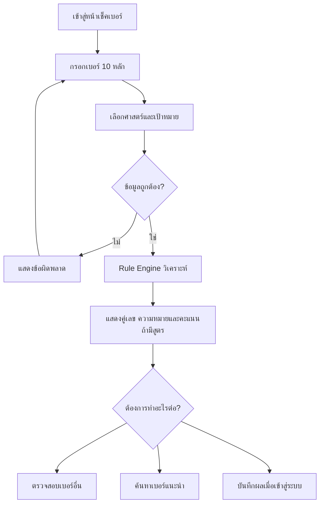
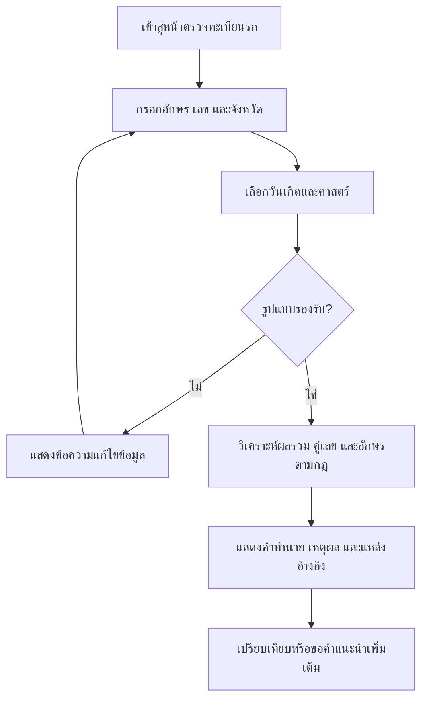

# User Stories & Requirement Review — LekVibe (ระบบวิเคราะห์เลขเบอร์โทรและทะเบียนรถ)

> **Document status:** Draft for Team Review  
> **Version:** 1.3 (v1.1: ระบบรีวิว EP-07 · v1.2: แหล่งอ้างอิงทะเบียนรถ Wongnai/tabien2you · v1.3: ตัดสิน Blocker — ลด MVP, ตอบ OQ หลัก)  
> **Prepared:** 2026-11-06  
> **Language:** Thai  
> **Purpose:** ใช้เป็นเอกสารตั้งต้นสำหรับ Product Discovery, Requirement Refinement, UX Design และ Technical Estimation  
> **Note:** เอกสารนี้เป็นข้อเสนอการออกแบบผลิตภัณฑ์ ไม่ใช่ข้อสรุปว่าทุกฟีเจอร์มีอยู่บนเว็บไซต์อ้างอิง

## 1. References

1. **เบอร์โทรศัพท์มงคล:** [DECODER159](https://decoder159.com/) — ใช้อ้างอิงแนวคิดการทำนายเบอร์ การจัดกลุ่มเบอร์ การค้นหาเบอร์ตามเงื่อนไข บทความ และการซื้อขายเบอร์
2. **ทะเบียนรถมงคล:** [Allianz — เลขทะเบียนรถมงคล](https://www.allianz.co.th/th_TH/did-you-know/motor-insurance-article/lucky-license-plates.html) — ใช้อ้างอิงแนวคิดการวิเคราะห์ตามวันเกิด ผลรวม ตัวเลขและตัวอักษรที่ควรหลีกเลี่ยง
3. **ทะเบียนรถมงคล:** [Wongnai — เลขทะเบียนรถมงคล](https://www.wongnai.com/articles/lucky-car-registration) — ใช้อ้างอิงสูตรผลรวม 2 แบบ (เฉพาะตัวเลข / รวมค่าอักษรตามหลักทักษา), ความหมายผลรวม, เลขมงคล/กาลกิณีตามวันเกิด, เลขแนะนำตามอาชีพ และคู่เลข/รูปแบบที่ควรหลีกเลี่ยง
4. **ผลรวมและซื้อขายทะเบียน:** [tabien2you — ผลรวมทะเบียน](https://tabien2you.com/sumtabienthai.php) — ใช้อ้างอิงแนวคิดรายการทะเบียนพร้อมผลรวม/ระดับดวง ราคา และสถานะ (ว่าง/จองแล้ว/ขายแล้ว) — หน้าเว็บไม่เปิดเผยสูตร จึงใช้อ้างอิงได้เฉพาะ UX ไม่ใช่กฎคำนวณ

> แหล่ง 1–3 อาจให้ตารางเลขตามวันเกิดไม่ตรงกัน ต้องเก็บเป็น Rule Set แยกตามแหล่งพร้อมเวอร์ชัน และห้ามใช้ถ้อยคำแนว "แม่นที่สุด" ในผลิตภัณฑ์

**ข้อควรระวัง:** ศาสตร์เลขมงคลเป็นเรื่องความเชื่อ ไม่ควรสื่อสารว่าเป็นผลลัพธ์ที่ได้รับการพิสูจน์ทางวิทยาศาสตร์ กฎและคำทำนายต้องระบุแหล่งอ้างอิง/เวอร์ชัน ก่อนขึ้น Production ต้องตรวจทานความถูกต้องของตารางเลขและคำทำนายกับแหล่งต้นฉบับอีกครั้ง และตรวจสอบสิทธิการใช้เนื้อหา ชื่อศาสตร์ ตราสัญลักษณ์ และข้อมูลจากเว็บไซต์อ้างอิง

### 1.1 Data Strategy (ยังไม่มีฐานข้อมูลจริง)

- ระยะแรกใช้ **Reference/Mock Data** ใน [`reference-data/`](reference-data/README.md) เป็น Seed ของ Rule Engine, UI และ Regression Tests
- ข้อดี/ข้อเสียของเลข ผลรวม วันเกิด และค่าอักษรที่สรุปจากแหล่งอ้างอิง เก็บเป็น Rule Set ที่มี `source` และ `version`
- ข้อมูลที่ยังไม่มีแหล่ง (นิยามประเภทเบอร์, ประกาศ, รีวิว) ใช้ Mock ที่มี `status: mock` และหน้าเว็บต้องแสดงป้าย "ข้อมูลตัวอย่าง"
- ก่อน Production ต้องแทน Mock ด้วยข้อมูลที่ Domain Expert อนุมัติ

## 2. Product Vision

สร้าง Web Application ให้ผู้ใช้ตรวจสอบและทำความเข้าใจ **เบอร์โทรศัพท์มงคล** และ **ทะเบียนรถมงคล** พร้อมคำอธิบายที่ตรวจสอบย้อนหลังได้ มีฐานความรู้ให้เรียนรู้ และสามารถต่อยอดสู่ Marketplace สำหรับประกาศขายเบอร์โทรศัพท์

### 2.1 Goals

- ให้ Guest วิเคราะห์เบอร์โทรศัพท์และทะเบียนรถได้ โดยไม่ต้องเข้าสู่ระบบ
- แสดงความหมายและเหตุผลจากกฎที่ระบุชัดเจน แทนการให้คะแนนโดยไม่มีที่มา
- แนะนำเบอร์ตามเป้าหมาย อาชีพ และประเภทเลขมงคล
- รองรับการดูแลฐานความรู้และกฎวิเคราะห์โดย Admin
- รองรับสมาชิก รีวิว ประวัติ และ Marketplace ในระยะถัดไป

### 2.2 Out of Scope สำหรับ MVP

- ระบบรับชำระเงิน / Escrow / การโอนกรรมสิทธิ์เบอร์
- การยืนยันว่าเลขทะเบียนรถว่างหรือสามารถจองได้จริง หากไม่มีแหล่งข้อมูลทางการ
- การรับประกันผลลัพธ์จากเลขมงคล
- การใช้ข้อมูลหรือสูตรเฉพาะที่ไม่มีสิทธิหรือไม่มีแหล่งตรวจสอบได้

## 3. Personas & Roles

| Role | Jobs to be Done |
| --- | --- |
| Guest | วิเคราะห์เลขเบื้องต้นโดยไม่สมัครสมาชิก |
| Member | บันทึกประวัติ เปรียบเทียบผลวิเคราะห์ รีวิว |
| Buyer | ค้นหาเบอร์มงคลที่มีประกาศขายและติดต่อผู้ขาย |
| Seller | ลงประกาศและจัดการสถานะเบอร์ที่ขาย |
| Content Editor | จัดการบทความและฐานความหมายตัวเลข |
| Admin | จัดการกฎ ผู้ใช้งาน รีวิว ประกาศ และ Audit Log |

## 4. Priority Definition

- **P0 / MVP:** ความสามารถหลักที่จำเป็นต่อการเปิดใช้ระบบวิเคราะห์เลข
- **P1 / Next:** ความสามารถเพิ่ม Engagement และประสบการณ์ผู้ใช้
- **P2 / Later:** ความสามารถซับซ้อนหรือขึ้นกับกระบวนการธุรกิจเพิ่มเติม

## 5. Epic Overview

| Epic | Scope | Stories |
| --- | --- | ---: |
| EP-01 | วิเคราะห์เบอร์โทรศัพท์ | 5 |
| EP-02 | ค้นหาและแนะนำเบอร์ | 4 |
| EP-03 | วิเคราะห์ทะเบียนรถ | 7 |
| EP-04 | Knowledge Base & บทความ | 3 |
| EP-05 | สมาชิกและการเปรียบเทียบ | 3 |
| EP-06 | Marketplace | 5 |
| EP-07 | รีวิวและความน่าเชื่อถือ | 9 |
| EP-08 | Admin & Rule Management | 6 |
| **Total** | | **42** |

---

## 6. EP-01 — วิเคราะห์เบอร์โทรศัพท์มงคล

### US-PH-001 — ตรวจสอบเบอร์โทรศัพท์ [P0]

**As a** Guest  
**I want to** กรอกเบอร์โทรศัพท์ 10 หลักและขอผลวิเคราะห์  
**So that** ฉันสามารถเข้าใจความหมายของเบอร์ที่ใช้งานได้

**Acceptance Criteria**
- [ ] รองรับรูปแบบหมายเลขมือถือไทย 10 หลักตามกฎ Validation ที่ตกลงกัน
- [ ] มีข้อความแจ้งเมื่อรูปแบบเลขไม่ถูกต้อง
- [ ] วิเคราะห์ได้โดยไม่ต้อง Login
- [ ] แสดงผลแยกด้าน เช่น การงาน การเงิน ความรัก สุขภาพ โชคลาภ **เฉพาะเมื่อศาสตร์ที่เลือกมีกฎรองรับ**
- [ ] แสดงศาสตร์ แหล่งอ้างอิง และเวอร์ชันกฎของผลลัพธ์

### US-PH-002 — วิเคราะห์คู่ตัวเลข [P0]

**As a** User  
**I want to** ดูความหมายของคู่เลขและตำแหน่งที่ใช้วิเคราะห์  
**So that** ฉันเข้าใจที่มาของผลลัพธ์

**Acceptance Criteria**
- [ ] แสดงคู่เลขตามลำดับและตำแหน่งที่ Rule Engine กำหนด
- [ ] มีคำอธิบายด้านสนับสนุนและข้อควรระวังเมื่อมีข้อมูล
- [ ] ระบุหมวดที่เกี่ยวข้องของแต่ละคู่เลข
- [ ] ถ้าไม่มี Rule ต้องแสดง `ไม่มีข้อมูล` ไม่สร้างคำทำนายขึ้นเอง

### US-PH-003 — คะแนนความเหมาะสมของเบอร์ [P1]

**As a** User  
**I want to** ดูคะแนนและภาพรวมความเหมาะสม  
**So that** ฉันเปรียบเทียบตัวเลือกได้ง่ายขึ้น

**Acceptance Criteria**
- [ ] นิยามสูตรและน้ำหนักคะแนนสำหรับแต่ละศาสตร์ก่อนพัฒนา
- [ ] แสดงคะแนนรวม 0–100 และคะแนนรายหมวด **หากมีสูตรที่ผ่านการอนุมัติ**
- [ ] อธิบายว่าคะแนนมาจากกฎใด ไม่ใช่การวัดความแม่นยำทางวิทยาศาสตร์
- [ ] กรณีสูตรยังไม่พร้อม ต้องซ่อนคะแนนและแสดงคำอธิบายเชิงคุณภาพแทน

### US-PH-004 — แนะนำเบอร์ตามอาชีพ [P0]

**As a** User  
**I want to** เลือกอาชีพหรือเป้าหมายการใช้งาน  
**So that** ฉันได้รับคำแนะนำที่สัมพันธ์กับสิ่งที่สนใจ

**Acceptance Criteria**
- [ ] เลือกอาชีพ เช่น ค้าขาย ธุรกิจ พนักงานออฟฟิศ ผู้บริหาร บริการ ฟรีแลนซ์
- [ ] เลือกเป้าหมาย เช่น เจรจา การเงิน ความสัมพันธ์
- [ ] แสดงคู่เลข/รูปแบบเบอร์ที่แนะนำพร้อมเหตุผลตามกฎ
- [ ] หากไม่มี Rule สำหรับอาชีพที่เลือก ใช้ผลวิเคราะห์ทั่วไปแทน

### US-PH-005 — เลือกศาสตร์การวิเคราะห์ [P1]

**As a** User  
**I want to** เลือกศาสตร์หรือสูตรวิเคราะห์  
**So that** ฉันเปรียบเทียบแนวทางการตีความได้

**Acceptance Criteria**
- [ ] แสดงรายชื่อศาสตร์ที่เปิดใช้งาน
- [ ] ระบุชื่อและเวอร์ชันกฎในทุกผลลัพธ์
- [ ] ไม่รวมคะแนนข้ามศาสตร์โดยไม่มีเกณฑ์ที่อนุมัติ
- [ ] รองรับการอธิบายกรณีผลตีความจากหลายศาสตร์ขัดแย้งกัน

## 7. EP-02 — ค้นหาและแนะนำเบอร์มงคล

### US-PH-006 — ค้นหาตามเลขและตำแหน่ง [P1]

**As a** User  
**I want to** กำหนดเลขที่ต้องการ/ไม่ต้องการและตำแหน่ง  
**So that** ฉันค้นหาตัวเลือกที่ตรงความต้องการได้

**Acceptance Criteria**
- [ ] ใส่เลขที่ต้องการและเลขที่ไม่ต้องการได้
- [ ] เลือกเงื่อนไขตำแหน่ง/ลำดับตามรูปแบบที่ออกแบบ
- [ ] มี Validation เมื่อเงื่อนไขขัดแย้งกัน
- [ ] แสดง Empty State และแนวทางผ่อนคลายตัวกรอง

### US-PH-007 — ค้นหาตามประเภทเบอร์ [P1]

**As a** User  
**I want to** เลือกหมวดเบอร์ เช่น มังกร หงส์ เศรษฐี VIP หรือเบอร์สวย  
**So that** ฉันเจอรูปแบบเลขที่สนใจ

**Acceptance Criteria**
- [ ] มีรายการประเภทที่เปิดใช้งาน
- [ ] แต่ละประเภทอธิบายเงื่อนไขการจัดกลุ่มได้
- [ ] ระบบสามารถใช้หลายเงื่อนไขร่วมกันตามนโยบายที่กำหนด
- [ ] ไม่จัดกลุ่มเบอร์เข้าประเภทโดยไม่มีกฎยืนยัน

### US-PH-008 — กรองเบอร์ตามราคา/เครือข่าย [P1]

**As a** Buyer  
**I want to** กรองประกาศตามราคา เครือข่าย และประเภทซิม  
**So that** ฉันเลือกเบอร์ภายในงบได้

**Acceptance Criteria**
- [ ] กำหนดช่วงราคาและเครือข่ายได้
- [ ] เรียงลำดับตามราคาได้
- [ ] แสดงเฉพาะประกาศตามสถานะและสิทธิ์การมองเห็น
- [ ] แสดงเงื่อนไขเมื่อไม่พบข้อมูล

### US-PH-009 — ระบบแนะนำเบอร์ที่เหมาะสม [P1]

**As a** User  
**I want to** รับชุดเบอร์ที่ใกล้เคียงกับเป้าหมายของฉัน  
**So that** ฉันมีตัวเลือกเพิ่มเติม

**Acceptance Criteria**
- [ ] รับข้อมูลเป้าหมาย อาชีพ และเงื่อนไขค้นหา
- [ ] แนะนำจากเบอร์ในแหล่งข้อมูลที่ระบบมีสิทธิเข้าถึง
- [ ] แสดงเหตุผลและข้อจำกัดของการแนะนำ
- [ ] ไม่แสดงว่าเบอร์มีสินค้าจริงหากไม่มีข้อมูลประกาศที่ยืนยันได้

---

## 8. EP-03 — วิเคราะห์ทะเบียนรถมงคล

### US-LP-001 — ตรวจสอบทะเบียนรถ [P0]

**As a** Guest  
**I want to** กรอกหมวดอักษรและเลขทะเบียน  
**So that** ฉันดูผลการวิเคราะห์ตามความเชื่อได้

**Acceptance Criteria**
- [ ] รับหมวดอักษร เลขทะเบียน และจังหวัด (กรณีเกี่ยวข้อง)
- [ ] Validation เฉพาะประเภทรูปแบบทะเบียนที่อยู่ใน Scope
- [ ] แยกอักษรและตัวเลขเพื่อใช้คำนวณ
- [ ] ใช้งานโดยไม่ Login ได้
- [ ] แสดงข้อจำกัดเมื่อพบรูปแบบทะเบียนที่ยังไม่รองรับ

### US-LP-002 — วิเคราะห์ตามวันเกิด [P0]

**As a** User  
**I want to** เลือกวันเกิดเพื่อดูความเหมาะสมของทะเบียน  
**So that** ฉันทราบเลขและอักษรที่แนะนำตามวันเกิด

**Acceptance Criteria**
- [ ] เลือกวันอาทิตย์–เสาร์ได้
- [ ] รองรับการแบ่งวันพุธกลางวัน/กลางคืน **ตามศาสตร์ที่เลือก**
- [ ] แสดงเลขส่งเสริม เลขที่ควรหลีกเลี่ยง และอักษรที่ควรหลีกเลี่ยง
- [ ] ระบุแหล่งที่มาของกฎในผลลัพธ์
- [ ] กรณีระบุวันเกิดเป็นวันที่จริง ต้องนิยามเวลาและเขตเวลาที่ใช้แบ่งวัน

### US-LP-003 — วิเคราะห์ผลรวมทะเบียน [P0]

**As a** User  
**I want to** ทราบผลรวมเลขทะเบียนและวิธีคำนวณ  
**So that** ฉันตรวจสอบเหตุผลได้ด้วยตนเอง

**Acceptance Criteria**
- [ ] นิยามสูตรอย่างชัดเจนว่าใช้เฉพาะตัวเลขหรือรวมค่าตัวอักษร
- [ ] แสดงตัวเลขที่ถูกนำมารวมและผลการบวก
- [ ] รองรับการลดผลรวมเป็นหลักเดียวเมื่อศาสตร์กำหนด
- [ ] แสดงคำอธิบายผลรวมจากฐานข้อมูลที่ผ่านการตรวจทาน
- [ ] รองรับ 2 สูตร: **(ก) เฉพาะตัวเลข** และ **(ข) รวมค่าอักษรตามตารางหลักทักษา** (ค่า 1–9) โดยตารางค่าอักษรจัดการผ่าน `US-AD-001` และแสดงค่าที่แปลงของแต่ละอักษร
- [ ] แสดงระดับผลรวม (เช่น ดีเยี่ยม / ปานกลาง / ควรเลี่ยง) เช่น 14/41, 15/51, 24/42, 36/63, 45/54, 56/65, 59/95 เป็นกลุ่มดี และ 13/31/37 เป็นกลุ่มควรเลี่ยง ตาม Rule Set ที่เลือก

### US-LP-004 — ตรวจสอบเลขและอักษรควรหลีกเลี่ยง [P0]

**As a** User  
**I want to** เห็นเลขหรืออักษรในทะเบียนที่เข้าข่ายควรหลีกเลี่ยง  
**So that** ฉันนำข้อมูลไปประกอบการตัดสินใจ

**Acceptance Criteria**
- [ ] ตรวจเลขและหมวดอักษรตามวันเกิด/ศาสตร์
- [ ] Highlight ตัวอักษรและเลขที่ตรงกฎ
- [ ] แสดงเหตุผลและข้อยกเว้นที่มีในฐานกฎ
- [ ] ระบุว่าเป็นความเชื่อ ไม่ใช่ข้อห้ามตามกฎหมาย
- [ ] ตรวจ **คู่เลขควรเลี่ยง** ตามกฎ เช่น 13/31/37/73/35/53 (ใจร้อน/อุบัติเหตุตามความเชื่อ), 00/03/30/07/70 (ซ่อมบ่อยตามความเชื่อ)
- [ ] ตรวจ **รูปแบบควรเลี่ยง** เช่น เลข 1 คร่อมหน้า-หลัง (1771, 1001) หรือเลขหน้ารวมเลขหลังได้ 13
- [ ] หลีกเลี่ยงถ้อยคำที่ทำให้ผู้ใช้กังวลเรื่องความปลอดภัยจริง และแสดงข้อความเตือนให้ขับขี่อย่างปลอดภัย

### US-LP-005 — วิเคราะห์คู่ตัวเลขทะเบียนรถ [P0]

**As a** User  
**I want to** อ่านความหมายของเลขคู่ภายในทะเบียน  
**So that** ฉันเห็นคำทำนายนอกเหนือจากผลรวม

**Acceptance Criteria**
- [ ] แสดงคู่เลขที่ติดกันตามสูตร
- [ ] มีคำอธิบายของแต่ละคู่เลขและแหล่งที่มา
- [ ] แสดงผลด้านสนับสนุน/ข้อควรระวังเมื่อกฎรองรับ
- [ ] หากไม่มีข้อมูลให้แสดงสถานะ `ไม่มีข้อมูล`

### US-LP-006 — แนะนำชุดเลขทะเบียน [P1]

**As a** User  
**I want to** รับตัวอย่างชุดเลขทะเบียนตามวันเกิดและเป้าหมาย  
**So that** ฉันใช้เป็นแนวทางเลือกเลขทะเบียนได้

**Acceptance Criteria**
- [ ] รับวันเกิดและเป้าหมายความสนใจ
- [ ] รับอาชีพ (ใช้รายการเดียวกับ `US-PH-004`) เช่น ค้าขาย/ออนไลน์, ราชการ/ครู, พนักงาน/บริการ/เซลส์, ช่าง/แพทย์/วิศวกร/เดินทางบ่อย แล้วแนะนำคู่เลขตามกฎของอาชีพนั้น
- [ ] สร้าง/คัดกรองชุดเลขจากกฎที่ผ่านการอนุมัติ
- [ ] แสดงเหตุผลว่าแนะนำเพราะอะไร
- [ ] เปรียบเทียบชุดเลขที่ผู้ใช้กำหนดเองได้
- [ ] ไม่ระบุว่าเลขสามารถจอง/ประมูลได้ หากไม่มีข้อมูลจากแหล่งทางการ

### US-LP-007 — ค้นหาประกาศทะเบียนตามผลรวม [P2]

**As a** Buyer  
**I want to** ค้นหาประกาศทะเบียนรถตามผลรวม ระดับผลรวม วันเกิด และราคา  
**So that** ฉันเจอทะเบียนที่ตรงความเชื่อและงบประมาณ

**Acceptance Criteria**
- [ ] รายการแสดงทะเบียน ผลรวม (ระบุสูตรที่ใช้) ระดับผลรวม ราคา และสถานะ Available/Reserved/Sold
- [ ] กรองตามผลรวม ระดับผลรวม เลขที่ต้องการ/ไม่ต้องการ วันเกิด และช่วงราคา
- [ ] ใช้ Rule Engine เดียวกับ `US-LP-003` เพื่อให้ผลรวมตรงกับหน้าวิเคราะห์
- [ ] ต้องยืนยันว่าการซื้อขาย/โอนทะเบียนทำได้ตามกฎหมายและระเบียบกรมการขนส่งทางบกก่อนเปิดใช้ (OQ-18)
- [ ] ใช้ Moderation, Report และ Audit Log เดียวกับ Marketplace เบอร์ (`US-MK-005`)

---

## 9. EP-04 — Knowledge Base & บทความ

### US-CT-001 — อ่านบทความเลขมงคล [P0]
**As a** User **I want to** อ่านบทความตามหมวด **so that** เข้าใจหลักการก่อนเลือกเลข
- [ ] มีหน้ารายการบทความและหน้าอ่านรายละเอียด
- [ ] แยกหมวดและค้นหาบทความได้
- [ ] มีข้อมูลผู้เขียน วันที่ปรับปรุง และแหล่งอ้างอิง

### US-CT-002 — ค้นหาความหมายคู่เลข [P0]
**As a** User **I want to** ค้นหาความหมายเลขคู่ เช่น 24, 36, 89 **so that** เรียนรู้คำอธิบายตามศาสตร์
- [ ] ค้นหาคู่เลขที่มีในฐานข้อมูลได้
- [ ] แสดงความหมายและชื่อศาสตร์
- [ ] แสดง `ไม่มีข้อมูล` เมื่อไม่มีรายการตรงกัน

### US-CT-003 — จัดการบทความผ่าน CMS [P1]
**As a** Content Editor **I want to** จัดการบทความ **so that** เผยแพร่ความรู้ได้โดยไม่ต้องแก้ไข Source Code
- [ ] Create/Edit/Draft/Publish/Unpublish
- [ ] กำหนด Category, Slug และ SEO Metadata
- [ ] มีสิทธิ์การจัดการและประวัติการแก้ไข

## 10. EP-05 — สมาชิกและการเปรียบเทียบ

### US-MB-001 — สมัครสมาชิก [P1]
**As a** Guest **I want to** สมัครและเข้าสู่ระบบ **so that** ใช้งานความสามารถเฉพาะสมาชิก
- [ ] มีระบบ Authentication ตามแนวทางที่ทีมกำหนด
- [ ] รองรับการยืนยันตัวตน/กู้คืนบัญชีตามความเสี่ยง
- [ ] ผู้ใช้จัดการและลบบัญชีได้ตามนโยบาย

### US-MB-002 — บันทึกประวัติการวิเคราะห์ [P1]
**As a** Member **I want to** เก็บผลวิเคราะห์ที่เลือก **so that** เปิดดูย้อนหลังได้
- [ ] บันทึกเบอร์/ทะเบียน ผลวิเคราะห์ วันที่ และเวอร์ชันกฎ
- [ ] ดูและลบประวัติของตนเองได้
- [ ] ประวัติเป็นข้อมูลส่วนตัวและต้องผ่าน Authorization

### US-MB-003 — เปรียบเทียบเบอร์หรือทะเบียน [P1]
**As a** Member **I want to** เปรียบเทียบผลหลายรายการ **so that** เลือกทางเลือกที่ตรงเป้าหมาย
- [ ] เลือกอย่างน้อยสองรายการเพื่อเปรียบเทียบได้
- [ ] แสดงหมวดการเปรียบเทียบด้วยกฎที่สอดคล้องกัน
- [ ] แจ้งเมื่อเปรียบเทียบผลจากต่างศาสตร์/เวอร์ชัน

## 11. EP-06 — Marketplace

### US-MK-001 — สร้างประกาศขายเบอร์ [P1]
**As a** Seller **I want to** ลงประกาศขายเบอร์ **so that** ผู้ซื้อค้นหาได้
- [ ] กรอกเบอร์ ราคา เครือข่าย รายละเอียด และช่องทางติดต่อ
- [ ] ตรวจสอบรูปแบบข้อมูลและการซ้ำของประกาศ
- [ ] มีสถานะ Draft/Pending/Active/Rejected/Sold
- [ ] กำหนดแนวทางยืนยันว่าผู้ลงประกาศมีสิทธิขาย/โอนหมายเลข

### US-MK-002 — จัดการประกาศ [P1]
**As a** Seller **I want to** แก้ไขหรือปิดประกาศ **so that** ข้อมูลการขายเป็นปัจจุบัน
- [ ] แก้ไขข้อมูลและเปลี่ยนสถานะได้ตามสิทธิ์
- [ ] ผู้ขายแก้ไขได้เฉพาะประกาศของตน
- [ ] เก็บประวัติการเปลี่ยนแปลงสำคัญ

### US-MK-003 — ค้นหาและดูรายละเอียดประกาศ [P1]
**As a** Buyer **I want to** ค้นหาประกาศและอ่านข้อมูล **so that** เลือกเบอร์ได้เหมาะสม
- [ ] มีรายการและหน้ารายละเอียดประกาศ
- [ ] กรอง/เรียงตามเงื่อนไขที่กำหนด
- [ ] แสดงข้อมูลราคา สถานะ และข้อจำกัดที่จำเป็น

### US-MK-004 — ติดต่อผู้ขาย [P1]
**As a** Buyer **I want to** ติดต่อผู้ขาย **so that** สอบถามรายละเอียดการซื้อได้
- [ ] ใช้ช่องทางติดต่อที่ Seller อนุญาต
- [ ] ไม่แสดงข้อมูลติดต่อที่ไม่ได้รับความยินยอม
- [ ] มีคำเตือนเรื่องความเสี่ยงจากการทำธุรกรรมภายนอก

### US-MK-005 — ตรวจสอบผู้ขายและรายงานประกาศ [P2]
**As a** Admin **I want to** ตรวจสอบและระงับประกาศเสี่ยง **so that** ลดโอกาสเกิดการหลอกลวง
- [ ] ผู้ใช้ Report ประกาศได้
- [ ] Admin พิจารณา อนุมัติ ระงับ และบันทึกเหตุผลได้
- [ ] เก็บ Audit Log ของการจัดการ

## 12. EP-07 — รีวิวและความน่าเชื่อถือ

**ประเภทรีวิว:** รีวิวประสบการณ์ใช้เลข (P0), รีวิวบริการ (P1), รีวิวผู้ขาย และรีวิวผู้ซื้อ (P2 — ขึ้นกับ Marketplace)

> **Dependency:** รีวิวประสบการณ์ใช้เลขเป็น P0 แต่ผู้เขียนต้องเป็น Member จึงต้องดึง `US-MB-001` (สมัครสมาชิก) ขึ้นเป็น P0 หรือกำหนดรูปแบบยืนยันตัวตนขั้นต่ำสำหรับผู้รีวิวใน MVP (ดู OQ-13)

### US-RV-001 — เขียนรีวิวประสบการณ์ใช้เลข [P1]
**As a** Member **I want to** รีวิวประสบการณ์หลังใช้เลข **so that** แบ่งปันมุมมองกับผู้ใช้อื่น
- [ ] มีปุ่ม **"ฉันใช้เลขนี้แล้ว"** ในหน้าผลวิเคราะห์ เพื่อบันทึกเลขที่ใช้และวันที่เริ่มใช้ แล้วเปิดให้เขียนรีวิว
- [ ] ให้ดาว 1–5 **แยกตามด้าน:** การงาน การเงิน ความรัก การสื่อสาร (ข้ามด้านที่ไม่เกี่ยวข้องได้)
- [ ] กรอกระยะเวลาที่ใช้เลข และอาชีพ (เลือกจากรายการใน `US-AD-003`)
- [ ] มีแท็กสำเร็จรูปให้เลือก และข้อความอิสระเป็นตัวเลือกเสริม เพื่อให้เขียนได้เร็ว
- [ ] สร้าง/แก้ไข/ลบรีวิวของตนเองได้ และทุกการแก้ไขต้องผ่าน Moderation ใหม่
- [ ] ระบุชัดว่าเป็นประสบการณ์ส่วนบุคคล ไม่ใช่การรับรองผลจากระบบ

### US-RV-002 — อ่านและกรองรีวิว [P1]
**As a** Guest **I want to** อ่านรีวิว **so that** มีข้อมูลประกอบการตัดสินใจ
- [ ] แสดงเฉพาะรีวิวที่เผยแพร่แล้ว
- [ ] กรองได้ตามประเภทรีวิว ด้าน อาชีพ ระยะเวลาใช้ และป้ายยืนยัน
- [ ] แสดงคะแนนเฉลี่ยรายด้านพร้อมจำนวนรีวิว และไม่แสดงค่าเฉลี่ยเมื่อจำนวนรีวิวต่ำกว่าเกณฑ์ขั้นต่ำ
- [ ] การเรียงลำดับเริ่มต้นต้องไม่ดันรีวิวบวกขึ้นก่อน
- [ ] มีช่องทางแจ้งรีวิวที่ไม่เหมาะสม

### US-RV-003 — Moderation รีวิว [P1]
**As a** Admin **I want to** ตรวจสอบรีวิวตาม Workflow **so that** ลดเนื้อหาผิดนโยบายโดยไม่บิดเบือนภาพรวม
- [ ] สถานะ Pending/Published/Rejected/Hidden พร้อมเหตุผลจากรายการเหตุผลที่กำหนด
- [ ] มี SLA ของการพิจารณา เช่น รีวิวใหม่และรีวิวที่ถูกรายงาน (ตัวเลขดู OQ-14) และแสดงคิวที่เกิน SLA
- [ ] **นโยบาย:** ห้ามซ่อนหรือปฏิเสธรีวิวด้วยเหตุผลว่าเป็นรีวิวเชิงลบเพียงอย่างเดียว เหตุผลต้องอ้างข้อนโยบายที่ชัดเจน
- [ ] ผู้เขียนได้รับแจ้งผลและเหตุผล และขออุทธรณ์ได้
- [ ] เก็บ Audit Log ของทุกการดำเนินการ และรายงานสัดส่วนรีวิวบวก/ลบที่ถูกซ่อน เพื่อตรวจสอบความเป็นกลาง

### US-RV-004 — กันรีวิวปลอม [P1]
**As a** Admin **I want to** ระบบป้องกันรีวิวปลอม **so that** รีวิวน่าเชื่อถือ
- [ ] จำกัด **1 บัญชีต่อ 1 เลขต่อประเภทรีวิว** (แก้ไขรีวิวเดิมได้ แต่สร้างซ้ำไม่ได้)
- [ ] ป้องกันผู้ขายรีวิวเลขหรือประกาศของตนเอง รวมถึงบัญชีที่เชื่อมโยงกัน
- [ ] ตรวจจับพฤติกรรมผิดปกติ เช่น รีวิวถี่ผิดปกติ บัญชีใหม่จำนวนมาก หรืออุปกรณ์/IP ซ้ำ แล้วส่งเข้าคิวตรวจสอบ ไม่ลบอัตโนมัติ
- [ ] ตรวจจับคำอ้างเกินจริง เช่น "รวยแน่นอน" หรือ "หายป่วย" แล้ว Flag ให้ Moderator พร้อมแจ้งผู้เขียนให้ปรับถ้อยคำ
- [ ] Rate limiting สำหรับการสร้างรีวิวและการรายงาน

### US-RV-005 — ความเป็นส่วนตัวของรีวิว [P1]
**As a** Member **I want to** รีวิวได้โดยไม่เปิดเผยข้อมูลส่วนตัว **so that** ฉันปลอดภัย
- [ ] แสดงชื่อเล่นหรือนามแฝงแทนชื่อจริง
- [ ] ตรวจจับเบอร์โทรศัพท์และข้อมูลติดต่อในเนื้อหารีวิว แล้วบล็อกหรือปิดบังก่อนเผยแพร่
- [ ] เลขที่รีวิวแสดงแบบปิดบังบางส่วนตามนโยบาย (ดู OQ-11)
- [ ] ผู้ใช้ลบรีวิวของตนได้ และการลบต้องมีผลกับการแสดงผลทุกจุด
- [ ] การนำรีวิวไปใช้ทำการตลาดต้องขอ **ความยินยอมแยก** (opt-in) ซึ่งถอนได้ และเป็นค่าเริ่มต้นแบบไม่ยินยอม

### US-RV-006 — เตือนให้รีวิวหลังใช้เลข [P1]
**As a** Member **I want to** ได้รับการเตือนให้รีวิวหลังใช้เลขไประยะหนึ่ง **so that** รีวิวสะท้อนประสบการณ์จริงตามเวลา
- [ ] เตือนที่ **30 / 90 / 180 วัน** นับจากวันที่กด "ฉันใช้เลขนี้แล้ว"
- [ ] ผู้ใช้เพิ่มรีวิวตามช่วงเวลา (Follow-up) โดยผูกกับรีวิวเดิม ไม่นับเป็นรีวิวใหม่
- [ ] ปิดการเตือนหรือเลือกช่องทางเตือนได้
- [ ] หยุดเตือนเมื่อผู้ใช้แจ้งว่าเลิกใช้เลขนั้นแล้ว

### US-RV-007 — ป้ายยืนยันรีวิว [P1]
**As a** User **I want to** เห็นป้ายยืนยันบนรีวิว **so that** แยกรีวิวที่มีหลักฐานจริงได้
- [ ] ระบบคำนวณป้ายจากหลักฐานจริงเท่านั้น เช่น กด "ฉันใช้เลขนี้แล้ว" ก่อนรีวิว ระยะเวลาใช้งานจริง หรือการซื้อผ่าน Marketplace (นิยามดู OQ-15)
- [ ] **ไม่มี Role ใด รวมถึง Admin แก้ไขป้ายด้วยมือได้** การเปลี่ยนป้ายเกิดได้จากการคำนวณใหม่เท่านั้น
- [ ] แสดงคำอธิบายว่าป้ายแต่ละแบบหมายถึงอะไร
- [ ] เก็บบันทึกหลักฐานและเวอร์ชันของเกณฑ์ที่ใช้คำนวณ

### US-RV-008 — รีวิวบริการ [P1]
**As a** Member **I want to** รีวิวบริการของเว็บไซต์ **so that** ทีมนำไปปรับปรุงได้
- [ ] ให้คะแนนและแสดงความเห็นต่อบริการวิเคราะห์/บทความ/การใช้งาน
- [ ] ใช้ Moderation, กันรีวิวปลอม และความเป็นส่วนตัวชุดเดียวกับ `US-RV-003`–`US-RV-005`

### US-RV-009 — รีวิวผู้ขายและผู้ซื้อ [P2]
**As a** Buyer/Seller **I want to** รีวิวคู่ค้าหลังติดต่อซื้อขาย **so that** ผู้ใช้อื่นประเมินความน่าเชื่อถือได้
- [ ] รีวิวได้เฉพาะคู่ที่มีหลักฐานการติดต่อ/ซื้อขายผ่านระบบ
- [ ] ผู้ถูกรีวิวตอบกลับได้หนึ่งครั้งต่อรีวิว แต่ลบรีวิวไม่ได้
- [ ] ขึ้นกับ Operating Model ของ Marketplace (OQ-09)

## 13. EP-08 — Admin & Rule Management

### US-AD-001 — จัดการความหมายตัวเลข [P0]
**As a** Admin **I want to** เพิ่มหรือปรับปรุงความหมายคู่เลข **so that** อัปเดตความรู้ได้โดยไม่แก้โค้ด
- [ ] จัดการเลข/คู่เลข ความหมาย หมวดศาสตร์ และแหล่งอ้างอิง
- [ ] ตรวจสอบความซ้ำ/ความครบถ้วนของข้อมูล
- [ ] มี Draft/Publish และ Version

### US-AD-002 — จัดการ Rule Engine [P0]
**As a** Admin **I want to** จัดการกฎที่ใช้ทำนาย **so that** เปลี่ยนกฎได้อย่างตรวจสอบย้อนหลังได้
- [ ] Rule มี `ruleId`, `source`, `version`, `status`, `effectiveAt`
- [ ] มี Preview/Test ก่อน Publish
- [ ] มี Regression Tests ครอบคลุมกรณีมาตรฐาน
- [ ] ผลวิเคราะห์ย้อนหลังเก็บเวอร์ชันกฎที่ใช้

### US-AD-003 — จัดการประเภทเบอร์และอาชีพ [P0]
**As a** Admin **I want to** จัดการหมวดหมู่ **so that** ระบบเพิ่มประเภทเบอร์และกลุ่มอาชีพได้
- [ ] CRUD หมวดเบอร์/อาชีพ/เป้าหมาย
- [ ] ผูกแต่ละหมวดกับกฎที่มีอยู่
- [ ] เปิด-ปิดการใช้งานแต่ละหมวดได้

### US-AD-004 — Dashboard การใช้งาน [P1]
**As a** Admin **I want to** ดูภาพรวมการใช้งาน **so that** ตัดสินใจพัฒนาผลิตภัณฑ์ได้
- [ ] แสดงจำนวนการตรวจสอบเบอร์และทะเบียน
- [ ] แสดงการใช้งานฟีเจอร์/บทความ/ประกาศโดยใช้ข้อมูลรวม
- [ ] จำกัดการเข้าถึงข้อมูลตาม Role และนโยบายข้อมูลส่วนบุคคล

### US-AD-005 — Audit Log และ Rollback Rule [P0 — ขั้นต่ำ: Approve + Rollback]
**As a** Admin **I want to** ตรวจสอบประวัติและย้อนกลับกฎ **so that** รับมือการเปลี่ยนแปลงผิดพลาดได้
- [ ] แสดงผู้แก้ไข เวลา และรายละเอียดที่เปลี่ยน
- [ ] มีขั้นตอน Approve/Publish/Rollback ที่กำหนดชัดเจน
- [ ] ทุกการ Rollback สร้างประวัติและไม่ลบประวัติเดิม

### US-AD-006 — สถิติผลลัพธ์จากผู้ใช้เพื่อปรับปรุงกฎ [P2]
**As a** Admin / Domain Expert **I want to** ระบบเก็บสถิติจากรีวิวและการใช้งาน **so that** ใช้เป็นหลักฐานประกอบการทบทวนกฎให้สอดคล้องกับประสบการณ์ผู้ใช้มากขึ้น
- [ ] เก็บข้อมูลแบบรวม (Aggregate) จากรีวิว `US-RV-001`/`US-RV-006`: ดาวรายด้าน × คู่เลข / ผลรวม / ประเภทเบอร์ / อาชีพ / วันเกิด / ระยะเวลาใช้ / เวอร์ชันกฎ
- [ ] ใช้เฉพาะข้อมูลจากผู้ใช้ที่ยินยอมให้ใช้เพื่อการวิเคราะห์ (แยกจากความยินยอมทางการตลาด) และตัดข้อมูลระบุตัวตนก่อนเข้าคลังสถิติ
- [ ] ไม่นับรีวิวที่ถูก Flag ว่าปลอม/ผิดปกติ (`US-RV-004`) และให้น้ำหนักรีวิวที่มีป้ายยืนยัน (`US-RV-007`) ตามเกณฑ์ที่อนุมัติ
- [ ] Dashboard แสดงค่าเฉลี่ย จำนวนตัวอย่าง ช่วงความเชื่อมั่น และซ่อนกลุ่มที่ตัวอย่างน้อยกว่าเกณฑ์ขั้นต่ำ
- [ ] **สถิติไม่เปลี่ยนกฎหรือคำทำนายอัตโนมัติ** — ผลที่ได้เป็นข้อเสนอให้ Domain Expert ทบทวน และการแก้กฎต้องผ่าน Workflow ของ `US-AD-002`/`US-AD-005`
- [ ] หากแสดงสถิติต่อผู้ใช้ ต้องแยกเป็นส่วน "สถิติจากผู้ใช้" ออกจากคำทำนายตามกฎ และระบุว่าเป็นข้อมูลที่ผู้ใช้รายงานเอง มีอคติในการเลือกตัวอย่าง และไม่ใช่การพิสูจน์ทางวิทยาศาสตร์
- [ ] ห้ามสื่อสารว่าระบบ "แม่นยำขึ้น" ในเชิงวิทยาศาสตร์ ให้ใช้ถ้อยคำเช่น "สอดคล้องกับประสบการณ์ผู้ใช้"

---

## 14. User Journeys

### 14.1 วิเคราะห์เบอร์โทรศัพท์

### 14.2 วิเคราะห์ทะเบียนรถ

## 15. Technical Considerations (Proposed)

**Architecture (ตัวเลือกเริ่มต้น):** Next.js Frontend → .NET Backend API → Numerology Rule Engine + Application Modules → PostgreSQL; เพิ่ม Cache/Search ตามปริมาณข้อมูลจริง

**Module Boundaries**
- `PhoneAnalysis`: validation, pair extraction, rules, explanations
- `LicensePlateAnalysis`: plate parsing, day-of-birth mapping, sum/pair/letter rules
- `RuleManagement`: rule publishing, versioning, preview, regression tests
- `Content`: knowledge base/articles/categories
- `Identity`: member identity, roles, authorization
- `Marketplace`: listings, moderation, seller/buyer operations
- `Review`: submissions, moderation, reporting

**Non-functional Requirements ที่ต้องกำหนดเพิ่ม**
- Security: authentication, authorization, input validation, rate limiting, audit trail
- Privacy: ไม่เปิดเผยเบอร์ที่ใช้ตรวจสอบโดยอัตโนมัติ, retention policy, delete/export ตามนโยบายและกฎหมายที่เกี่ยวข้อง
- Performance: กำหนด latency/SLO หลังทราบ expected traffic
- SEO: public landing pages, article metadata, structured data ที่เหมาะสม
- Observability: API logs, metrics, tracing, error monitoring
- Rule correctness: deterministic results, version-pinned analysis, regression test cases
- Accessibility: form labels, keyboard navigation, readable errors

## 16. Suggested MVP Backlog

> **v1.3:** ลด MVP เพื่อปลด Blocker ตาม Review Report §12 — สถานะ **Proposed, รอ PO Sign-off**

**Phase 1 — Core Analysis (P0, 14 Stories)**

`US-PH-001`, `US-PH-002`, `US-PH-004`, `US-LP-001`, `US-LP-002`, `US-LP-003`, `US-LP-004`, `US-LP-005`, `US-CT-001`, `US-CT-002`, `US-AD-001`, `US-AD-002`, `US-AD-003`, `US-AD-005` (ขั้นต่ำ: Approve + Rollback)

- ใช้ **1 ศาสตร์ / 1 Rule Set** แบบ fixed — แสดงชื่อ Rule Set และเวอร์ชันบนหน้าผลลัพธ์ ไม่มี selector (US-PH-005 คง P1)
- `US-CT-001` ใน MVP = บทความ **Static (Markdown ใน repo)** — CMS (US-CT-003) คง P1
- Guest-only: ไม่มีระบบสมาชิกใน Phase 1

**ย้ายออกจาก Phase 1**

| Story | ย้ายไป | เหตุผล |
| --- | --- | --- |
| US-PH-003 คะแนน 0–100 | P1 | ยังไม่มีสูตร/น้ำหนักที่อนุมัติ (OQ-03) — ทดสอบไม่ได้ |
| US-PH-006, US-PH-007 ค้นหาเบอร์ | P1 (มาพร้อม Marketplace) | ไม่มีแหล่งข้อมูลเบอร์ใน MVP |
| US-RV-001 – US-RV-005 รีวิว | P1 (มาพร้อม US-MB-001) | ต้องเป็น Member + ความเสี่ยง PDPA ต้องทำ DPIA ก่อน |

**Phase 2 — Personalization & Engagement**

สมาชิก (US-MB-001) ประวัติ เปรียบเทียบ คะแนนเบอร์ เลือกศาสตร์ ผลแนะนำ บทความ CMS รีวิว (EP-07) และรายงานการใช้งาน

**Phase 3 — Marketplace**

ประกาศขาย ค้นหาเบอร์ (US-PH-006/007/008) ค้นหาตามราคา/เครือข่าย ติดต่อผู้ขาย และการตรวจสอบความเสี่ยง

## 17. Open Questions สำหรับ Workshop

> ป้าย: **Decided (v1.3)** = ตัดสินด้าน Scope/Product แล้ว รอ PO Sign-off · **Assumption** = ค่าตั้งต้นให้ทีมเริ่มงานได้ แต่ Domain Expert/Legal ต้องยืนยันก่อน Go-live · **Deferred** = ตามฟีเจอร์ที่ถูกเลื่อน

| ID | คำถามที่ต้องตัดสินใจ | Owner (เสนอ) | Decision |
| --- | --- | --- | --- |
| OQ-01 | จะใช้ศาสตร์ใดเป็น Default และได้รับอนุญาตให้ใช้สูตรเฉพาะหรือไม่? | PO / Domain Expert / Legal | **Decided (scope) + Assumption (content):** MVP ใช้ 1 Rule Set ที่ทีมเรียบเรียงเองจากความรู้สาธารณะ พร้อมอ้างอิงแหล่ง — ห้ามคัดลอกข้อความ/สูตรเฉพาะของเว็บอ้างอิง; Legal ตรวจก่อน Go-live (ไม่ Block Dev) |
| OQ-02 | คู่เลขของเบอร์คำนวณจากตำแหน่งใดบ้าง? | Domain Expert | **Decided (CR 2026-11-07):** คู่ติดกันตำแหน่ง 4–10 (ไม่ดู 3 หลักแรก) = 6 คู่ — เดิม Assumption ตำแหน่ง 2–10 = 8 คู่ |
| OQ-03 | คะแนน 0–100 ใช้น้ำหนักเท่าไร ใครอนุมัติ? | PO / Domain Expert | **Deferred** — US-PH-003 ย้ายเป็น P1 |
| OQ-04 | ความหมายเลขมังกร หงส์ เศรษฐี นิยามอย่างไร? | Domain Expert | **Deferred** — US-PH-007 ย้ายเป็น P1 |
| OQ-05 | ทะเบียนรถรองรับชนิดใดบ้าง เช่น รถยนต์/จักรยานยนต์/ป้ายพิเศษ? | PO | **Decided:** MVP รองรับป้ายรถยนต์ส่วนบุคคลรูปแบบมาตรฐาน `[เลข 1 หลัก (ไม่บังคับ)][พยัญชนะไทย 1–2 ตัว][เลข 1–4 หลัก]` เช่น `กข 1234`, `1กข 234`; จังหวัด = ไม่บังคับและไม่มีผลต่อการคำนวณ; จักรยานยนต์/ป้ายพิเศษ = Out of Scope |
| OQ-06 | วันพุธกลางคืนกำหนดช่วงเวลาอย่างไร? | Domain Expert | **Assumption:** ผู้ใช้เลือก "พุธกลางวัน / พุธกลางคืน" เอง (ไม่ถามวันที่/เวลาเกิดจริง); แสดงคำอธิบายช่วง 18:00–05:59 |
| OQ-07 | ผลรวมทะเบียนรวมตัวอักษรหรือไม่ และหากมีหลายศาสตร์ต้องแยกสูตรอย่างไร? | Domain Expert | **Decided:** แสดงทั้ง 2 ผลรวมพร้อมป้ายชัดเจน — (1) เฉพาะตัวเลข (2) รวมค่าอักษรตามตารางทักษา; ตารางค่าอักษร = Assumption รอ Domain Expert ยืนยัน |
| OQ-08 | จำเป็นต้องตรวจสอบเลขทะเบียนว่างจริงหรือไม่ และมีสิทธิใช้ข้อมูลจากแหล่งทางการใด? | PO / Legal / Integration | **Decided:** ไม่ตรวจใน MVP (Out of Scope §2.2) แสดงข้อความว่าไม่ได้ยืนยันสถานะทะเบียน |
| OQ-09 | Marketplace เป็นเพียง Listing หรือต้องมีธุรกรรมซื้อขายในระบบ? | PO / Business | **Decided:** Listing + ติดต่อผู้ขายเท่านั้น (ไม่มีธุรกรรมในระบบ) — Phase 3 |
| OQ-10 | ต้องยืนยัน Seller และสิทธิการครอบครองเบอร์อย่างไร? | Business / Legal | **Deferred** — Phase 3 |
| OQ-11 | ต้องเก็บข้อมูลเบอร์ที่ Guest วิเคราะห์หรือไม่ เก็บนานแค่ไหน? | PO / Privacy | **Decided:** ไม่เก็บเบอร์/ทะเบียนที่ Guest กรอก; เก็บเฉพาะสถิติรวม (จำนวนครั้ง, ประเภทการวิเคราะห์); Log ต้อง mask ค่า |
| OQ-12 | การ Review เนื้อหาและการ Publish กฎต้องผ่านกี่ขั้น? | Product / Admin | **Decided:** 2 ขั้น — Content Editor สร้าง Draft → Admin Approve/Publish; ห้ามผู้สร้าง Approve เอง; Rollback ไปเวอร์ชันก่อนหน้าได้ทันที |
| OQ-13 | ผู้รีวิวใน MVP ต้องเป็น Member เต็มรูปแบบ หรือใช้การยืนยันตัวตนขั้นต่ำ (เช่น OTP)? | PO / Engineering | **Decided:** ไม่มีรีวิวใน MVP — EP-07 ย้ายเป็น P1 และผู้รีวิวต้องเป็น Member |
| OQ-14 | SLA ของ Moderation (รีวิวใหม่ / รีวิวที่ถูกรายงาน) และเกณฑ์จำนวนรีวิวขั้นต่ำก่อนแสดงค่าเฉลี่ย? | PO / Ops | **Deferred** — Phase 2 |
| OQ-15 | หลักฐานใดบ้างที่ใช้คำนวณป้ายยืนยัน และมีกี่ระดับ? | PO / Engineering / Legal | **Deferred** — Phase 2 |
| OQ-16 | ช่องทางเตือนรีวิว 30/90/180 วัน (Email / Push / LINE) และต้องขอความยินยอมอย่างไร? | PO / Privacy | **Deferred** — Phase 2 |
| OQ-17 | รายการคำอ้างเกินจริงและแท็กสำเร็จรูป ใครเป็นผู้กำหนดและอนุมัติ? | Content / Legal | **Deferred** — Phase 2 |
| OQ-18 | ระบบจะมีประกาศซื้อขายทะเบียนรถหรือไม่ และทำได้ตามระเบียบกรมการขนส่งทางบกหรือไม่? | PO / Legal | **Deferred** — US-LP-007 (P2) รอ Legal |
| OQ-19 | ต้องเทียบตารางเลขตามวันเกิดของ Allianz กับ Wongnai หากไม่ตรงกันจะใช้ชุดใดเป็น Default? | Domain Expert | **Assumption:** Default = Wongnai (ตารางครบกว่า: ผลรวม 2 แบบ + กาลกิณี); เก็บ Allianz เป็น Rule Set แยก (ไม่เปิดใช้ใน MVP) |
| OQ-20 | เกณฑ์ขั้นต่ำของจำนวนตัวอย่าง วิธีถ่วงน้ำหนัก และจะแสดงสถิติต่อผู้ใช้หรือใช้ภายในเท่านั้น? | PO / Data / Domain Expert / Privacy | **Deferred** — US-AD-006 (P2) |

### 17.1 Validation เบอร์โทรศัพท์ (US-PH-001) — Decided

| กรณี | ตัวอย่าง | ผล |
| --- | --- | --- |
| มือถือ 10 หลัก ขึ้นต้น 06/08/09 | `0812345678` | ✅ ผ่าน |
| มีขีด/ช่องว่าง | `081-234-5678`, `081 234 5678` | ✅ Normalize เป็น `0812345678` |
| รูปแบบสากล | `+66812345678`, `66812345678` | ✅ Normalize เป็น `0812345678` |
| เบอร์บ้าน 9 หลัก / ขึ้นต้น 02–05, 07 | `021234567` | ❌ "รองรับเฉพาะเบอร์มือถือ" |
| ความยาวผิด / มีตัวอักษร | `08123`, `08a2345678` | ❌ "กรุณากรอกเบอร์มือถือ 10 หลัก" |

### 17.2 Blocker ที่ยังเหลือ (ต้องได้จากคนนอกทีม)

1. **Domain Expert:** ยืนยัน Assumption ของ OQ-02, 06, 07, 19 และส่ง **Golden Test Cases** อย่างน้อย 10 เคสต่อฟีเจอร์ (input → expected output) — Dev เริ่มทำ Rule Engine แบบ config ได้ก่อน แต่ Story จะ Done เมื่อ Golden Tests ผ่าน
2. **Legal:** ตรวจสิทธิการใช้เนื้อหาตาม OQ-01 และข้อความ Disclaimer — Block Go-live, ไม่ Block Dev
3. **PO:** Sign-off รายการ MVP §16 และ Decision ทั้งหมดใน v1.3

## 18. Team Review Checklist

### Product / Business Analysis
- [ ] Product Vision และเป้าหมายทางธุรกิจชัดเจน
- [ ] ทุก User Story มี Persona, Value และขอบเขตที่ยืนยันแล้ว
- [ ] Priorities ได้รับการยืนยันจาก PO
- [ ] แยก MVP / Next / Later อย่างมีเหตุผล
- [ ] Open Questions มี Owner และ Decision Date

### Domain Expert / Content
- [ ] มีแหล่งอ้างอิงคำทำนายที่อนุญาตให้นำมาใช้
- [ ] สูตรคู่เลขและผลรวมถูกนิยามครบถ้วน
- [ ] กฎทะเบียนตามวันเกิดและอักษรมี Test Cases
- [ ] คำทำนายไม่สื่อว่าได้รับการพิสูจน์ทางวิทยาศาสตร์
- [ ] มีผู้รับผิดชอบอนุมัติ/แก้ไข Rule

### UX/UI
- [ ] User Journey รองรับ Guest-first
- [ ] Error/Empty/Loading States ครบ
- [ ] ผู้ใช้เห็นที่มาของผลวิเคราะห์
- [ ] Form รองรับ Mobile, Accessibility และการตรวจข้อมูลผิดรูปแบบ

### Engineering / QA
- [ ] API Contracts และ Data Model กำหนดครบ
- [ ] Rules deterministic และมี versioning
- [ ] Authorization ครอบคลุม Member/Seller/Admin
- [ ] มี Unit, Integration, Regression และ Security Tests
- [ ] มี Logging, Monitoring, Rate Limiting และ Privacy Controls

## 19. Definition of Ready (ก่อนเริ่ม Story)

- [ ] Story มี Business Value และ Acceptance Criteria ตรวจสอบได้
- [ ] ข้อมูล Input/Output และ Validation ชัดเจน
- [ ] กฎเลขศาสตร์ที่เกี่ยวข้องได้รับการอนุมัติ
- [ ] มี Wireframe หรือ UX Flow (ถ้าต้องใช้)
- [ ] Dependency และ External Integration ระบุแล้ว
- [ ] ทีมสามารถ Estimate และแตก Technical Tasks ได้

## 20. Review Notes / Decision Log

| Date | Topic | Decision | Owner | Status |
| --- | --- | --- | --- | --- |
| 2026-11-06 | MVP Scope | ลดเหลือ 14 Stories; ย้าย US-PH-003/006/007 และ EP-07 เป็น P1; ดึง US-AD-005 (ขั้นต่ำ) เป็น P0 | PO | Accepted (Demo) |
| 2026-11-06 | Default numerology rules | 1 Rule Set fixed, Default ตาม Wongnai, คู่เลขตำแหน่ง 2–10 (เปลี่ยนเป็น 4–10 ดูแถว 2026-11-07), ผลรวมทะเบียน 2 แบบ | Domain Expert | Accepted (Demo) |
| 2026-11-06 | Registration plate supported formats | รถยนต์ส่วนบุคคลมาตรฐานเท่านั้น จังหวัดไม่มีผลต่อการคำนวณ | PO | Accepted (Demo) |
| 2026-11-06 | Phone validation | มือถือ 10 หลัก 06/08/09 + normalize ขีด/ช่องว่าง/+66 (§17.1) | PO / SA | Accepted (Demo) |
| 2026-11-06 | Guest data retention | ไม่เก็บค่าที่ Guest กรอก เก็บเฉพาะสถิติรวม | PO / Privacy | Accepted (Demo) |
| 2026-11-06 | Rule publish workflow | Editor Draft → Admin Approve; Rollback ได้ทันที | PO | Accepted (Demo) |
| 2026-11-06 | Content in MVP | บทความ Static (Markdown) | PO | Accepted (Demo) |
| 2026-11-06 | Marketplace operating model | Listing + ติดต่อผู้ขาย ไม่มีธุรกรรม (Phase 3) | PO / Business | Accepted (Demo) |
| 2026-11-06 | Project context | โปรเจกต์นี้เป็น Demo (การบ้าน) — ผู้ทำโปรเจกต์มอบให้ Claude ตัดสินแทน PO/Domain Expert; ทุก Decision ถือเป็น Accepted (Demo) และต้องทบทวนใหม่หากนำไปใช้จริง | Owner | Accepted (Demo) |
| 2026-11-06 | Plate Rule Set Default | `plate-wongnai-v1` เป็น Default (มีผลรวม 2 แบบ + ระดับผลรวม + อาชีพ); `plate-allianz-v1` เก็บไว้แต่ปิดใน MVP — ไม่รวมสองตารางเพราะขัดแย้งกัน 7/8 วัน | Claude | Accepted (Demo) |
| 2026-11-06 | อักษรควรเลี่ยงตามวันเกิด | Wongnai ไม่มีตารางอักษร จึงใช้ `avoidLetters` จาก Allianz เป็น Rule Component แยก พร้อมระบุแหล่ง "Allianz" ในผลลัพธ์ | Claude | Accepted (Demo) |
| 2026-11-06 | Rule precedence (35/53) | ลำดับ: **ควรเลี่ยง > แนะนำตามอาชีพ > ความหมายทั่วไป** → 35/53 แสดงเป็น "ควรระวัง" พร้อมเหตุผลทั้งสองด้าน และไม่ใช้เป็นเลขแนะนำ | Claude | Accepted (Demo) |
| 2026-11-07 | ชื่อผลิตภัณฑ์ | เปลี่ยนชื่อจาก "เลขมงคล · Mongkol Number" เป็น **LekVibe** (Tagline: "เช็กไวบ์เลข ก่อนเลือกเบอร์และป้าย") — ชื่อทางเทคนิค (`mongkol-db`, `mongkol-net`, `mongkol-pgdata`) คงเดิม | Owner | Accepted (Demo) |
| 2026-11-07 | คู่เลขเบอร์โทร (OQ-02, BR-PH-05) | Change Request: ไม่ดู 3 หลักแรก อ่านคู่ติดกันตั้งแต่ตำแหน่ง 4–10 = **6 คู่** (เดิม 2–10 = 8 คู่) — อัปเดต Golden PR-001–008, TEST-DATA PD-G, TEST-PLAN, verify-api | Owner | Accepted (Demo) |
| 2026-11-07 | เสนอเลขทะเบียนตามวันเกิด (FR-LP-12) | Change Request: เลือกแค่วันเกิด → เสนอเลข 2–4 หลัก ≤ 8 เลข ประกอบจากกฎเดิม (เลขส่งเสริมของวัน, คู่/รูปแบบควรเลี่ยง, ผลรวม excellent) ไม่สร้างกฎใหม่ · หมวดอักษรไม่บังคับ · API `POST /api/v1/plate/suggest` | Owner | Accepted (Demo) |
| 2026-11-06 | ตารางค่าอักษร (ทักษา) | ใช้ `letterValues` ใน `plate-rules.json` ตามเดิม (ฎ ฏ ฐ = 9 ตาม Wongnai) | Claude | Accepted (Demo) |
| 2026-11-06 | ความหมายคู่เลขเบอร์โทร | ใช้ `pair-meanings.json` เป็น Rule Set `pairs-common-belief-mock` (Default ของ Demo); คู่ที่ไม่มีในไฟล์แสดง `ไม่มีข้อมูล`; UI แสดงป้าย "ข้อมูลตัวอย่าง" | Claude | Accepted (Demo) |
| 2026-11-06 | ประเภทเบอร์ (P1) | ใช้นิยาม Mock ใน `phone-categories.json` (มังกร = มี 789 หรือ 78/87 + 89/98) | Claude | Accepted (Demo) |
| 2026-11-06 | Data source | ไม่มีฐานข้อมูลจริง ใช้ไฟล์ใน [`reference-data/`](reference-data/README.md) เป็น Seed และ Golden Test Cases | Claude | Accepted (Demo) |

---

**Next step (Demo):** Decision ทั้งหมด Accepted แล้ว → เขียน Golden Test Cases จาก `reference-data/` → แตก API, Database Schema และ Sprint Backlog ของ 14 Stories ใน Phase 1
